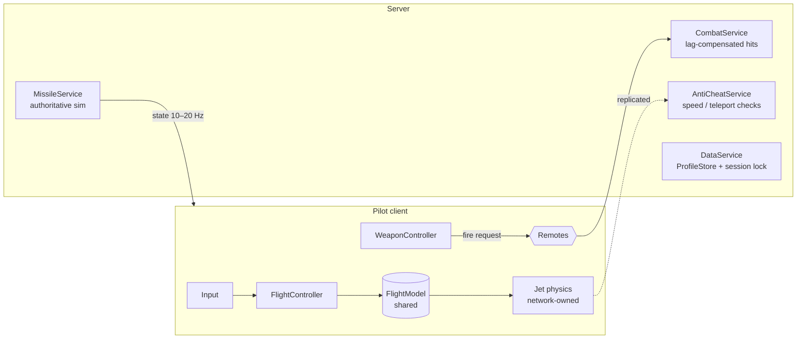

<div align="center">


<br />

**Energy fighting. Defeatable missiles. A career from 1970s jets to sixth-gen concepts.**

[](https://create.roblox.com)
[](https://luau.org)
[](https://rojo.space)
[](#roadmap)

[**Design doc**](docs/DESIGN.md) · [**Dev instructions**](docs/DEVELOPMENT.md) · [**Progress**](docs/PROGRESS.md) · [**Art pipeline**](docs/art/AIRCRAFT_PIPELINE.md) · [**Roadmap**](#roadmap) · [**Getting started**](#getting-started) · [**Project layout**](#project-layout)

</div>

## What is Afterburner?

Afterburner is a Roblox dogfighting game inspired by DCS World. It isn't a full simulator: there are no cold starts and no 60-key bindings. It keeps the decisions that make air combat tense.

- Speed and altitude are your resources, and every hard turn spends them.
- Guns need lead, and every missile can be flared, notched, chaffed or outrun.
- The important questions (where is the enemy, am I locked, is a missile coming) can be answered in three seconds. The depth sits underneath.
- You start in an F-5E or a MiG-21 and work up the tech tree towards the F-22 and beyond.
- Battle-rating matchmaking keeps eras together, and money buys style, never a stronger jet.

## Gameplay

<table>
<tr>
<td width="50%" valign="top">

### Flight
- A physics-flavoured flight model: thrust, lift, drag and gravity
- Stalls, G-LOC grey-out, corner speed and transonic drag
- Cockpit view first, with era-based cockpits (analogue, glass, wide-area display)
- Mouse Aim, Direct, gamepad and touch controls

</td>
<td width="50%" valign="top">

### Combat
- Raycast guns with travel time, a lead pipper and component damage
- IR, semi-active and active radar missiles that run out of energy
- Radar, RWR and notching, with data link and stealth at the high tiers
- Flares and chaff that reward good timing

</td>
</tr>
<tr>
<td valign="top">

### Modes
- In the game now: Dogfight (free-for-all against players and AI pilots), Free Flight and three training lessons
- Planned: Team Deathmatch, Air Superiority, Strike Escort, PvE co-op, Ranked Duels and BVR Battles
- Air-to-air only for now; ground targets may come in a later update

</td>
<td valign="top">

### Progression
- Three tech-tree branches: NATO, Soviet/Russia and Europe
- XP, research points and Credits, with upgrade modules per jet
- Paint schemes per jet, bought with Credits for now
- Monetisation is cosmetics and convenience only

</td>
</tr>
</table>

## The hangar

Eight jets are in the game today, covering Tiers I to III: the F-5E, MiG-21bis and Mirage IIIE, the F-4E, MiG-23MLD and Mirage F1C, and the F-16A and MiG-29A. The F-5E has its final model, with moving control surfaces and four paint schemes; the other seven are still greybox models. The full roster runs from 1970s starter jets to a sixth-generation prestige concept:

```mermaid
flowchart LR
    T1["<b>Tier I</b><br/>F-5E · MiG-21bis<br/>Mirage III"] --> T2["<b>Tier II</b><br/>F-4E · MiG-23MLD<br/>Mirage F1"]
    T2 --> T3["<b>Tier III</b><br/>F-14A · F-16A<br/>MiG-29A · Mirage 2000C"]
    T3 --> T4["<b>Tier IV</b><br/>F-15C · F/A-18C<br/>Su-27S · Tornado F3"]
    T4 --> T5["<b>Tier V</b><br/>F-16C · F-15E · Su-30SM<br/>MiG-29SMT · Gripen C"]
    T5 --> T6["<b>Tier VI</b><br/>Super Hornet · Su-35S<br/>Typhoon · Rafale"]
    T6 --> T7["<b>Tier VII</b><br/>F-22A · F-35A · Su-57"]
    T7 --> T8["<b>Prestige</b><br/>Tempest-class concept"]

    style T1 fill:#2b3a55,stroke:#5b7bb0,color:#fff
    style T2 fill:#2b3a55,stroke:#5b7bb0,color:#fff
    style T3 fill:#34405e,stroke:#7a96c9,color:#fff
    style T4 fill:#34405e,stroke:#7a96c9,color:#fff
    style T5 fill:#4a3b5e,stroke:#a383d1,color:#fff
    style T6 fill:#4a3b5e,stroke:#a383d1,color:#fff
    style T7 fill:#6b3a2a,stroke:#ff8a3d,color:#fff
    style T8 fill:#8a2a1a,stroke:#ffc58a,color:#fff
```



> [!NOTE]
> Real aircraft names are used wherever allowed; otherwise the names are semi-fictional but recognisable. There are no manufacturer logos. The prestige jet is a concept inspired by the UK-led Tempest programme, with made-up stats, because no real figures are public. See [design doc §6.4](docs/DESIGN.md#64-naming-policy-decided).

## Architecture

Flight is client-authoritative and combat is server-authoritative. The pilot's client flies the jet, so the controls have no network delay. The server checks every jet's movement, simulates the missiles and decides every hit.



The full breakdown is in [design doc §9](docs/DESIGN.md#9-technical-architecture).

<a id="project-layout"></a>

## Project layout

Scripts live as files in this repo and are synced into Studio with [Rojo](https://rojo.space). The map, terrain, jet models and skins live in the place file.

```
afterburner/
├── default.project.json   # Rojo: maps src/, tests/, tools/ and the packages into the DataModel
├── rokit.toml             # pinned toolchain (Rojo, StyLua, Selene, Wally, Lune)
├── wally.toml             # packages: React (UI), ProfileStore (saves)
├── stylua.toml · selene.toml
├── Afterburner.rbxl       # the place: map, terrain, jet models, skins
├── .github/workflows/     # CI: integrity checks, model contract, format, lint, Rojo build
├── docs/
│   ├── DESIGN.md          # game design document
│   ├── DEVELOPMENT.md     # engineering spec: every system, task and acceptance test
│   ├── PROGRESS.md        # task tracker, ticked only when tested
│   ├── art/               # aircraft art pipeline, marketing art
│   ├── playtests/         # playtest logs
│   └── testing/           # network test checklist
├── assets/                # README art
├── scripts/               # CI scripts (integrity checks, model contract check with Lune)
├── tools/  → ServerStorage.Tools      # Studio tools (assembler, map builders, economy sim)
│   └── blender/                       # Blender scripts: jet generator, paint, reference overlay
├── tests/  → ServerStorage.Tests      # TestRunner + *.spec modules
└── src/
    ├── shared/   → ReplicatedStorage.Shared              (flight model, data, rules, Net, Util)
    ├── server/   → ServerScriptService.Server            (Main + Services/)
    └── client/   → StarterPlayer.StarterPlayerScripts.Client  (Main + Controllers/, React UI/)
```

Run the unit tests in Studio (Edit mode, command bar):

```lua
require(game.ServerStorage.Tests.TestRunner).run()
```

<a id="getting-started"></a>

## Getting started

You need [Roblox Studio](https://create.roblox.com), [Git](https://git-scm.com) and [Rokit](https://github.com/rojo-rbx/rokit). Rokit installs the pinned versions of Rojo and the other tools. [Blender](https://www.blender.org) is only needed to rebuild or repaint jet models.

```bash
git clone https://github.com/wgw0/afterburner.git
```

```bash
cd afterburner
```

```bash
rokit install
```

```bash
wally install
```

```bash
rojo serve
```

Then:
1. Open `Afterburner.rbxl` in Roblox Studio.
2. Install the Rojo Studio plugin (from the Creator Store, or with `rojo plugin install`).
3. In Studio, open the Rojo plugin and click Connect. Scripts in `src/` now sync live into the place.
4. Press Play to test, or use Test → Clients and Servers for multiplayer.

> [!TIP]
> While Rojo is connected, edit scripts in your code editor, not in Studio, or Rojo will overwrite your Studio edits. When you change the map, models or skins, save the place and commit the `.rbxl` with your code.

<a id="roadmap"></a>

## Roadmap

| Phase | Focus | Status |
|:---:|---|:---:|
| 0 | Foundation: toolchain, boot order, Net layer, test runner, CI, test range | Done |
| 1 | Flight model prototype: cockpit camera, two contrasting jets | Done |
| 2 | Guns and component damage | Done |
| 3 | Missiles, radar, RWR and countermeasures | Done |
| 4 | Match loop: Dogfight, AI pilots, first map, tutorial, touch controls | Done |
| 5 | Progression and saving: tech tree Tiers I–III, BR matchmaking | Done |
| 6 | Content and polish for a soft launch: about 15 jets with final art, TDM and Air Superiority | In progress |
| 7 | Monetisation: shop, VIP, Season 1 pass | Not started |
| 8 | Launch and live ops: Tiers V–VIII, squadrons, ranked, BVR | Not started |

Each phase ends with a playable build and an exit test. Phase 6 so far: the F-5E has its final model and four paint schemes, jets have moving control surfaces, and the skin picker is in. Task-level status is in [PROGRESS.md](docs/PROGRESS.md), and the phase checklists are in [design doc §10](docs/DESIGN.md#10-build-plan-steps-to-follow).

<details>
<summary><b>Decision log</b></summary>

<br />

| Topic | Decision |
|---|---|
| Tooling | Git and GitHub, with a Rojo-based layout |
| Aircraft names | Real where allowed, otherwise semi-fictional but recognisable |
| Camera | Cockpit first, with third person as a fallback |
| Ground targets | Not for now; possibly a later update |
| Respawn model | Still open: decide after playtesting the match loop (Dogfight uses a 5 s respawn timer meanwhile) |

</details>

## Monetisation principles

> Nothing bought with Robux makes a jet turn harder, hit harder or see further than its free equivalent.

On sale: camos, contrails, kill markers and nose art, a season pass, premium jets at the same BR and stats as free ones, VIP, capped boosters and private servers.

Never on sale: loot boxes, top-tier jets, performance upgrades, or revives in PvP.

## Licence

No licence has been chosen yet, so all rights are reserved by default. Please don't reuse the code or assets without permission.

<div align="center">
<br />
<sub>Built in Roblox Studio with Luau · <i>Check six.</i></sub>
</div>
