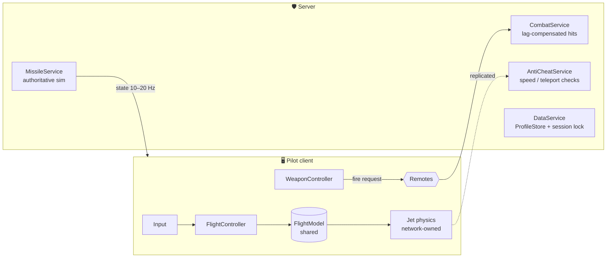

<div align="center">



<br />

**Energy fighting. Defeatable missiles. A career from 1980s jets to sixth-gen concepts.**

[](https://create.roblox.com)
[](https://luau.org)
[](https://rojo.space)
[](#-roadmap)

[**Design doc**](docs/DESIGN.md) · [**Dev instructions**](docs/DEVELOPMENT.md) · [**Progress**](docs/PROGRESS.md) · [**Roadmap**](#-roadmap) · [**Getting started**](#-getting-started) · [**Project layout**](#-project-layout)

</div>

---

## ✈️ What is Afterburner?

Afterburner is a Roblox dogfighting game inspired by **DCS World**. It isn't a full simulator: there are no cold starts and no 60-key bindings. But it keeps the decisions that make real air combat tense:

- 🔋 **Energy is everything.** Speed and altitude are your resources. Every hard turn spends them.
- 🎯 **Every kill is earned.** Guns need lead. Every missile can be flared, notched, chaffed or outrun.
- 👁️ **Readable in three seconds.** Where's the enemy? Am I locked? Is a missile coming? Depth sits underneath, not on top.
- 🛩️ **The hangar is the dream.** Start in an F-5E or MiG-21 and work your way up to the F-22 and beyond.
- ⚖️ **Fair at every tier.** Battle-rating matchmaking keeps eras together. Money buys style, never stronger jets.

## 🎮 Gameplay at a glance

<table>
<tr>
<td width="50%" valign="top">

### 🧭 Flight
- Physics-flavoured flight model: thrust, lift, drag and gravity
- Stalls, G-LOC grey-out, corner speed and transonic drag
- **Cockpit view first**, with era-based cockpits (analogue → glass → wide-area display)
- Mouse Aim, Direct, gamepad and touch control schemes

</td>
<td width="50%" valign="top">

### 💥 Combat
- Raycast guns with travel time, lead pipper and component damage
- IR, SARH and active radar missiles that run out of energy
- Radar, RWR, notching, data link and stealth (at high tiers)
- Flares and chaff that reward good timing

</td>
</tr>
<tr>
<td valign="top">

### 🗺️ Modes
- Dogfight FFA · Team Deathmatch · Air Superiority
- Strike Escort · PvE co-op · Ranked Duels · BVR Battles
- Air-to-air only for now. Ground targets may come in a future update.

</td>
<td valign="top">

### 📈 Progression
- Three-branch tech tree: **NATO**, **Soviet/Russia**, **Europe**
- XP, research points and credits, plus per-jet upgrade modules
- Aircraft mastery, daily challenges and seasons
- Ethical monetisation: cosmetics and convenience only

</td>
</tr>
</table>

## 🛫 The hangar

From a 1960s–80s starter jet to a sixth-generation prestige concept:



```mermaid
flowchart LR
    T1["<b>Tier I</b><br/>F-5E · MiG-21bis<br/>Mirage III"] --> T2["<b>Tier II</b><br/>F-4E · MiG-23MLD<br/>Mirage F1"]
    T2 --> T3["<b>Tier III</b><br/>F-14A · F-16A<br/>MiG-29A · Mirage 2000C"]
    T3 --> T4["<b>Tier IV</b><br/>F-15C · F/A-18C<br/>Su-27S · Tornado F3"]
    T4 --> T5["<b>Tier V</b><br/>F-16C · F-15E · Su-30SM<br/>MiG-29SMT · Gripen C"]
    T5 --> T6["<b>Tier VI</b><br/>Super Hornet · Su-35S<br/>Typhoon · Rafale"]
    T6 --> T7["<b>Tier VII</b><br/>F-22A · F-35A · Su-57"]
    T7 --> T8["<b>Prestige</b><br/>Tempest-class concept"]

    style T1 fill:#2b3a55,stroke:#5b7bb0,color:#fff
    style T2 fill:#2b3a55,stroke:#5b7bb0,color:#fff
    style T3 fill:#34405e,stroke:#7a96c9,color:#fff
    style T4 fill:#34405e,stroke:#7a96c9,color:#fff
    style T5 fill:#4a3b5e,stroke:#a383d1,color:#fff
    style T6 fill:#4a3b5e,stroke:#a383d1,color:#fff
    style T7 fill:#6b3a2a,stroke:#ff8a3d,color:#fff
    style T8 fill:#8a2a1a,stroke:#ffc58a,color:#fff
```

> [!NOTE]
> **Naming policy:** real names are used wherever allowed, otherwise semi-fictionalised but recognisable ones. No manufacturer logos. The prestige jet is a *concept* inspired by the UK-led Tempest programme, with fictionalised stats, because no real figures are public. See [design doc §6.4](docs/DESIGN.md#64-naming-policy--decided).

## 🏗️ Architecture

**Client-authoritative flight, server-authoritative combat.** The pilot's client flies the jet for zero-latency control. The server validates movement, simulates missiles and decides every hit.



The full breakdown is in [design doc §9](docs/DESIGN.md#9-technical-architecture).

## 📁 Project layout

Scripts live as files in this repo and are synced into Studio with [Rojo](https://rojo.space). The map, terrain and models live in the place file.

```
afterburner/
├── 📄 default.project.json   # Rojo: maps src/ and tests/ into the DataModel
├── 📄 rokit.toml             # pinned toolchain (Rojo, StyLua, Selene, Wally)
├── 📄 stylua.toml · selene.toml · wally.toml
├── 🎮 Afterburner.rbxl       # the place: map, terrain, models
├── ⚙️ .github/workflows/     # CI: format check, lint, Rojo build
├── 📚 docs/
│   ├── DESIGN.md             # full game design document
│   ├── DEVELOPMENT.md        # engineering spec: every system, task and acceptance test
│   └── PROGRESS.md           # task tracker, ticked only when tested
├── 🎨 assets/                # README art and source images
├── 🧪 tests/     → ServerStorage.Tests                   (TestRunner + *.spec modules)
└── 🧩 src/
    ├── shared/   → ReplicatedStorage.Shared              (Boot, Config, Net, Util…)
    ├── server/   → ServerScriptService.Server            (Main + Services/)
    └── client/   → StarterPlayer.StarterPlayerScripts.Client  (Main + Controllers/)
```

**Run the unit tests** in Studio (Edit mode, command bar):

```lua
require(game.ServerStorage.Tests.TestRunner).run()
```

## 🚀 Getting started

**You'll need:** [Roblox Studio](https://create.roblox.com), [Git](https://git-scm.com) and [Rokit](https://github.com/rojo-rbx/rokit). Rokit installs the pinned Rojo version for you.

```bash
git clone https://github.com/wgw0/afterburner.git
```

```bash
cd afterburner
```

```bash
rokit install
```

```bash
rojo serve
```

Then:
1. Open `Afterburner.rbxl` in Roblox Studio.
2. Install the **Rojo** Studio plugin (from the Creator Store, or with `rojo plugin install`).
3. In Studio, open the Rojo plugin and click **Connect**. Scripts in `src/` now sync live into the place.
4. Press **Play** to test, or use **Test → Clients and Servers** for multiplayer.

> [!TIP]
> Edit scripts in your code editor, not in Studio, while Rojo is connected. Otherwise Rojo overwrites your Studio edits. Save the place (Ctrl+S) when you change the map or models, and commit the `.rbxl` along with your code.

## 🗺️ Roadmap

| Phase | Focus | Status |
|:---:|---|:---:|
| **0** | Foundation: toolchain, boot order, Net layer, test runner, CI, test range | ✅ Done ([progress](docs/PROGRESS.md)) |
| **1** | **Flight model prototype**: cockpit camera, two contrasting jets | ✅ Done |
| **2** | Guns and component damage | ✅ Done |
| **3** | Missiles, radar, RWR and countermeasures | ✅ Done |
| **4** | Match loop MVP: FFA, AI pilots, first map, tutorial, touch controls | 🟡 Built, awaiting sign-off |
| **5** | Progression and saving: tech tree Tiers I–III, BR matchmaking | ⚪ |
| **6** | Content and polish for a soft launch: about 15 jets, TDM and Air Superiority | ⚪ |
| **7** | Monetisation: cosmetics shop, VIP, Season 1 pass | ⚪ |
| **8** | Launch and live ops: Tiers V–VIII, squadrons, ranked, BVR | ⚪ |

Each phase ends with a playable build and an exit test. See [design doc §10](docs/DESIGN.md#10-build-plan-steps-to-follow) for the full checklists.

<details>
<summary><b>📋 Decision log</b></summary>

<br />

| Topic | Decision |
|---|---|
| Tooling | ✅ Git + GitHub, Rojo-based layout |
| Aircraft names | ✅ Real where allowed, otherwise semi-fictional but recognisable |
| Camera | ✅ Cockpit first, with third person as a fallback |
| Ground targets | ✅ Not for now. Possibly a future update |
| Respawn model | ⏳ Decide after playtesting the match loop |

</details>

## 💰 Monetisation principles

> **Never pay-to-win.** Nothing bought with Robux makes a jet turn harder, hit harder or see further than its free equivalent.

✅ Camos, contrails, kill markers, nose art · ✅ Season pass · ✅ Premium jets at the *same* BR and stats as free ones · ✅ VIP and capped boosters · ✅ Private servers
❌ No loot boxes · ❌ No buying top-tier jets or performance upgrades · ❌ No paid revives in PvP

## 📜 License

No licence has been chosen yet, so **all rights are reserved** by default. Please don't reuse code or assets without permission.

<div align="center">
<br />
<sub>Built in Roblox Studio with Luau · <i>Check six.</i></sub>
</div>
