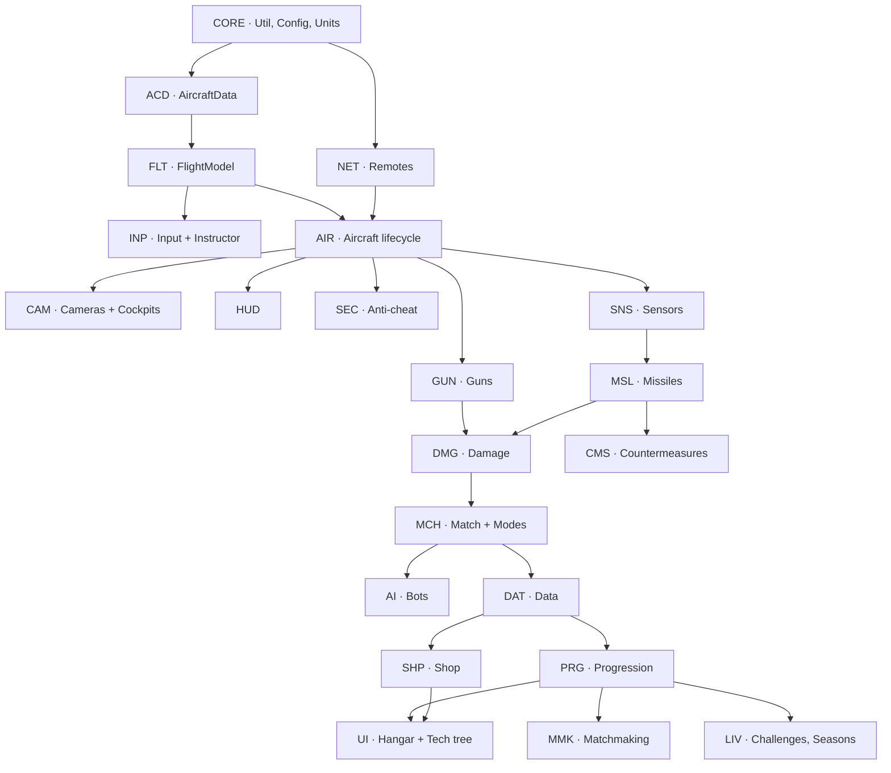
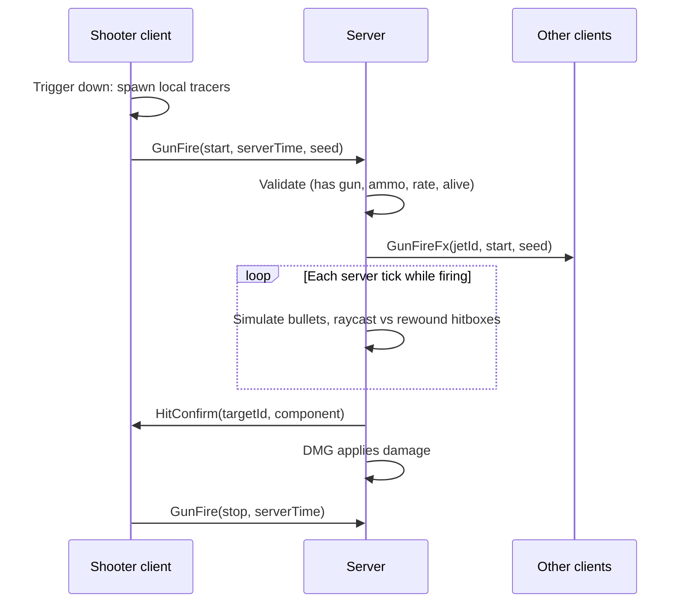

# Afterburner: development instruction set

> The engineering companion to [DESIGN.md](DESIGN.md). DESIGN.md says **what** the game is. This document says **exactly what to build**: every system's files, public API, data, network messages, algorithms, tasks and acceptance tests.

**Status:** v0.1 · **Applies to:** Phases 0–8 · **Language:** Luau (`--!strict` everywhere possible)

---

## How to use this document

- Every system has a **code prefix** (for example `FLT` for flight). Tasks are numbered `FLT-01`, `FLT-02`… and can be copied straight into GitHub Issues.
- Every task lists the **phase** it belongs to (from DESIGN.md §10). Build in phase order. Inside a phase, follow the dependency arrows in §2.
- A task is **done** only when its acceptance test passes (see §0.8, Definition of Done).
- Numbers marked *(tune)* are starting values to be adjusted in playtests. Put them in config, never hard-code them.

## Contents

- [0. Engineering foundations](#0-engineering-foundations)
- [1. Project structure and boot](#1-project-structure-and-boot)
- [2. System map and dependencies](#2-system-map-and-dependencies)
- [3. Shared core (CORE)](#3-shared-core-core)
- [4. Networking layer (NET)](#4-networking-layer-net)
- [5. Aircraft data and assets (ACD)](#5-aircraft-data-and-assets-acd)
- [6. Flight model (FLT)](#6-flight-model-flt)
- [7. Controls and input (INP)](#7-controls-and-input-inp)
- [8. Cameras and cockpits (CAM)](#8-cameras-and-cockpits-cam)
- [9. HUD and instruments (HUD)](#9-hud-and-instruments-hud)
- [10. Aircraft lifecycle (AIR)](#10-aircraft-lifecycle-air)
- [11. Guns and ballistics (GUN)](#11-guns-and-ballistics-gun)
- [12. Damage model (DMG)](#12-damage-model-dmg)
- [13. Missiles (MSL)](#13-missiles-msl)
- [14. Sensors: radar, RWR, data link, stealth (SNS)](#14-sensors-radar-rwr-data-link-stealth-sns)
- [15. Countermeasures (CMS)](#15-countermeasures-cms)
- [16. Anti-cheat and validation (SEC)](#16-anti-cheat-and-validation-sec)
- [17. Match framework and game modes (MCH)](#17-match-framework-and-game-modes-mch)
- [18. AI pilots (AI)](#18-ai-pilots-ai)
- [19. Maps and world (MAP)](#19-maps-and-world-map)
- [20. Effects (FX)](#20-effects-fx)
- [21. Audio (AUD)](#21-audio-aud)
- [22. Player data and persistence (DAT)](#22-player-data-and-persistence-dat)
- [23. Progression and economy (PRG)](#23-progression-and-economy-prg)
- [24. Tech tree, hangar and menus (UI)](#24-tech-tree-hangar-and-menus-ui)
- [25. Matchmaking and server topology (MMK)](#25-matchmaking-and-server-topology-mmk)
- [26. Challenges, achievements, seasons, squadrons (LIV)](#26-challenges-achievements-seasons-squadrons-liv)
- [27. Monetisation and shop (SHP)](#27-monetisation-and-shop-shp)
- [28. Tutorial and onboarding (TUT)](#28-tutorial-and-onboarding-tut)
- [29. Settings and accessibility (SET)](#29-settings-and-accessibility-set)
- [30. Analytics and telemetry (ANL)](#30-analytics-and-telemetry-anl)
- [31. Live ops, admin and config (OPS)](#31-live-ops-admin-and-config-ops)
- [32. Compliance, safety and moderation (CMP)](#32-compliance-safety-and-moderation-cmp)
- [33. Testing strategy (TST)](#33-testing-strategy-tst)
- [34. Performance budgets (PRF)](#34-performance-budgets-prf)
- [35. Release process (REL)](#35-release-process-rel)
- [36. The Ground Roamer (VEH)](#36-the-ground-roamer-veh)
- [37. Implementation notes: work done outside the plan](#37-implementation-notes-work-done-outside-the-plan)
- [Appendix A: Remote catalogue](#appendix-a-remote-catalogue)
- [Appendix B: Attributes and tags](#appendix-b-attributes-and-tags)
- [Appendix C: Phase-by-phase task index](#appendix-c-phase-by-phase-task-index)

---

## 0. Engineering foundations

### 0.1 Toolchain

| Tool | Purpose | Notes |
|---|---|---|
| **Roblox Studio** | Place editing, playtesting, profiling | Built-in MCP server is enabled for AI-assisted work |
| **Rojo** | Sync `src/` files into Studio | Pinned in `rokit.toml` |
| **Rokit** | Installs pinned CLI tools | `rokit install` |
| **Wally** | Luau package manager | Pinned in `rokit.toml`. `wally.toml` in the repo root |
| **StyLua** | Formatter | Pinned in `rokit.toml`. Config in `stylua.toml` |
| **Selene** | Linter | Pinned in `rokit.toml`. Config in `selene.toml` with the `roblox` std |
| **Lune** | Runs Luau outside Roblox; reads the place file in CI | Pinned in `rokit.toml`. `lune run scripts/validate-models.luau` checks the aircraft models in `Afterburner.rbxl` (ACD-03) |
| **luau-lsp** | Type checking and autocomplete in your editor | VS Code extension ("Luau Language Server"). Uses `sourcemap.json` from `rojo sourcemap` |
| **TestRunner** (in-house) | Unit tests for pure modules | `tests/TestRunner.luau`, synced to `ServerStorage.Tests` (§33) |
| **GitHub Actions** | CI: integrity checks, model contract, format check, lint, Rojo build | `.github/workflows/ci.yml` (§35) |

> **Why an in-house test runner instead of Jest-Lua:** Jest-Lua needs a Studio feature flag (`debug.loadmodule`) to be switched on by editing Studio's settings files. A ~200-line runner covers what the pure modules need, runs in Edit mode from the command bar or the Studio MCP tools, and clones modules before requiring them, so edits synced by Rojo are always picked up.

Pin the **exact** version of every tool in `rokit.toml` at the moment you add it, and never use floating versions.

### 0.2 Third-party packages (Wally)

| Package | Use | Realm |
|---|---|---|
| **ProfileStore** (loleris) | Session-locked player data | Server. If it isn't on Wally, vendor it into `src/server/Vendor/` with its licence. |
| **React (react-lua) + ReactRoblox** | Hangar, shop, menus | Client |

Packages install to `Packages/` (git-ignored, restored with `wally install`). Add a `Packages` entry under `ReplicatedStorage` in `default.project.json` when the first dependency is added.

Keep the dependency list short. Everything else (Signal, Trove, Spring, networking) is small enough to write in-house in `src/shared/Util`, so we own and understand it.

### 0.3 Coding standards

- `--!strict` at the top of every module. Use `--!nonstrict` only with a comment explaining why.
- Naming: `PascalCase` for modules, services, types and public functions. `camelCase` for locals and private functions. `SCREAMING_SNAKE` for constants.
- One module, one job. Pure maths (flight, ballistics, guidance, economy) lives in `shared` with **no Roblox instance access**, so it can be unit tested and reused by the server and AI.
- Services and controllers expose a typed table. No globals and no `_G`.
- Every server function that receives client data **validates first** (§16).
- No `wait()`, `spawn()` or `delay()`. Use `task.wait`, `task.spawn` and `task.delay`.
- Connections are owned by a `Trove`. Every jet, match and UI screen cleans up after itself.
- Units are SI internally (metres, m/s, kg, newtons, radians). Convert to studs only at the boundary (§3.2).
- Comments explain *why*, not *what*.

### 0.4 Git workflow

- `master` is always playable.
- Feature branches: `feat/FLT-03-stall-model`, `fix/GUN-07-tracer-offset`.
- PRs are squash-merged. The PR title includes the task ID.
- Commit the place file (`Afterburner.rbxl`) **only** when map or model content changes, and say so in the PR. Binary conflicts can't be merged, so tell anyone else working on it before you edit the place.

### 0.5 Configuration rule

All tunable numbers live in config modules under `src/shared/Config/` (shared) or `src/server/Config/` (secret, such as economy and anti-cheat thresholds). Live overrides are applied on top by `ConfigService` (§31).

### 0.6 Environments

| Environment | What it is | Used for |
|---|---|---|
| **Local** | Studio with Rojo connected | Daily development |
| **Test universe** | A separate, private Roblox experience | Multiplayer tests, purchases with test products, matchmaking across places |
| **Production** | The public experience | Releases only, from tagged commits |

Keep **separate experiences** for test and production, so DataStores, MemoryStores and products never mix. `Shared.Config.Environment` works out the environment from the experience (`game.GameId`, the same on the server and clients): the test experience (listed in `TEST_UNIVERSES`) and Studio are `"Test"`, any other experience live is `"Prod"`. It switches DataStore names and enables debug tools in test only. Publishing to production needs no switch, and debug tools can't switch on in production by accident (REL-04). In Studio only, an `Environment = "Prod"` attribute on `ReplicatedStorage` tries production behaviour.

### 0.7 Shared vocabulary

| Term | Meaning |
|---|---|
| **Jet** | A spawned aircraft instance in the world |
| **Airframe** | An aircraft *type* defined in `AircraftData` (for example `F16C`) |
| **Pilot** | The player (or AI) flying a jet |
| **Lineup** | Up to three airframes a player brings into a match |
| **BR** | Battle rating of an airframe |
| **Tick** | One server `Heartbeat` step |

### 0.8 Definition of Done (every task)

1. Code is formatted (StyLua), linted (Selene) and type-checks cleanly (luau-lsp).
2. Pure logic has unit tests that pass.
3. The acceptance test in this document has been run in Studio, and **Test → Clients and Servers** has been used for anything networked.
4. There are no errors or warnings in the Output window during the test.
5. The relevant section of this document is updated if the design changed.

---

## 1. Project structure and boot

### 1.1 Source tree

The tree as built. Modules planned for later phases are listed after it.

```
src/
├── shared/                          → ReplicatedStorage.Shared
│   ├── Config/
│   │   ├── Scale.luau               -- world/speed scale factors
│   │   ├── Flight.luau              -- global flight constants (air density curve, g)
│   │   ├── Economy.luau             -- rewards, costs, modules, lineup slots
│   │   ├── Settings.luau            -- known settings keys, ranges, defaults
│   │   ├── Skins.luau               -- paint schemes per airframe, prices
│   │   └── Environment.luau         -- reads the environment attribute
│   ├── Boot.luau                    -- Init/Start loader for services and controllers
│   ├── Types.luau                   -- shared type definitions
│   ├── Units.luau                   -- SI <-> studs, knots, feet, Mach
│   ├── Atmosphere.luau              -- density, speed of sound vs altitude
│   ├── FlightModel.luau             -- pure: forces, AoA, limits, step()
│   ├── Instructor.luau              -- pure: mouse-aim autopilot
│   ├── Ballistics.luau              -- pure: bullet step, lead solution
│   ├── Guidance.luau                -- pure: proportional navigation, seekers, ARH tracking
│   ├── Signature.luau               -- pure: IR/RCS signature maths
│   ├── Countermeasures.luau         -- pure: flare and chaff physics, decoy rolls
│   ├── DamageModel.luau             -- pure: component health, flight modifiers, kill credit
│   ├── PoseHistory.luau             -- pure: pose ring buffer and interpolation (lag compensation)
│   ├── MovementCheck.luau           -- pure: speed, teleport and acceleration checks
│   ├── AIBrain.luau                 -- pure: AI pilot decisions
│   ├── MatchRules.luau              -- modes as data, respawn rules
│   ├── LessonRunner.luau            -- pure: tutorial lesson steps
│   ├── Matchmaking.luau             -- BR bands, AI airframe choice
│   ├── PlayerData.luau              -- save schema, migrations, replica, deltas
│   ├── Progression.luau             -- rewards, research, purchase, modules, skins, lineup
│   ├── TechTree.luau                -- research graph (nodes, edges, costs)
│   ├── Skins.luau                   -- applies a skin's SurfaceAppearances to a jet model
│   ├── ControlSurfaces.luau         -- pure: stick/body rates -> surface deflections
│   ├── AircraftModelContract.luau   -- model validator (§5.3)
│   ├── AircraftData/                -- one module per airframe + init (registry)
│   ├── WeaponData/                  -- one module per weapon + init (registry)
│   ├── Net/
│   │   ├── init.luau                -- typed remote wrapper (§4)
│   │   ├── Definitions.luau         -- every remote declared here
│   │   └── Pack.luau                -- buffer packing for hot paths
│   └── Util/
│       ├── Signal.luau
│       ├── Trove.luau
│       ├── Spring.luau
│       ├── RingBuffer.luau
│       ├── Pool.luau
│       └── Validate.luau            -- type/range/finite checks
├── server/                          → ServerScriptService.Server
│   ├── Main.server.luau
│   ├── Lib/
│   │   └── Telemetry.luau           -- analytics wrapper (§30)
│   └── Services/
│       ├── DataService.luau
│       ├── DiagnosticsService.luau
│       ├── AircraftService.luau
│       ├── HistoryService.luau      -- position history for lag compensation
│       ├── CombatService.luau       -- guns + damage
│       ├── MissileService.luau      -- missiles + countermeasures
│       ├── SensorService.luau       -- lock validation, RWR
│       ├── AntiCheatService.luau
│       ├── MatchService.luau
│       ├── AIService.luau
│       ├── DroneService.luau        -- target drones (test environment)
│       ├── ProgressionService.luau
│       └── AdminService.luau
└── client/                          → StarterPlayer.StarterPlayerScripts.Client
    ├── Main.client.luau
    ├── Controllers/
    │   ├── PlayerDataController.luau
    │   ├── SettingsController.luau
    │   ├── DiagnosticsController.luau
    │   ├── InputController.luau
    │   ├── FlightController.luau
    │   ├── SensorController.luau        -- radar and RWR picture
    │   ├── WeaponController.luau
    │   ├── CameraController.luau
    │   ├── CockpitController.luau
    │   ├── ControlSurfaceController.luau -- animates control surfaces on every nearby jet
    │   ├── HUDController.luau
    │   ├── ScopesController.luau        -- radar and situation displays
    │   ├── GEffectsController.luau      -- grey-out, blackout, red-out
    │   ├── EffectsController.luau
    │   ├── MissileViewController.luau   -- interpolates server missiles
    │   ├── CombatFxController.luau
    │   ├── AudioController.luau
    │   ├── ToneController.luau          -- seeker, lock and RWR tones
    │   ├── MatchController.luau
    │   ├── TutorialController.luau
    │   ├── TouchController.luau
    │   ├── MenuController.luau          -- owns menu state, mounts the React app
    │   └── DebugController.luau         -- test-environment-only tuning panel
    └── UI/                              -- React: App, Components, Theme, JetPreview, Screens/

tests/                               → ServerStorage.Tests (TestRunner, *.spec, Smoke)
tools/                               → ServerStorage.Tools (Studio tools, run from the command bar)
├── GreyboxBuilder.luau, TerrainBuilder.luau, StraitBuilder.luau, EconomySim.luau, ExploitTest.luau
├── AircraftAssembler.luau           -- imported FBX + manifest -> game-ready jet
├── SceneryBuilder.luau              -- roads, towns, farms, woods and airbase buildings on the Strait
├── SkyBuilder.luau                  -- sky, sun, haze, clouds, colour grade and the grass variants
├── Manifests/                       -- per-airframe model manifests written by the Blender generator
└── blender/                         -- Blender scripts (not synced): f5e_generate.py, f5e_paint.py,
                                        mig21_generate.py, mig21_paint.py, scenery_generate.py, sky_paint.py,
                                        terrain_paint.py,
                                        overlay_reference.py, render_views.py
scripts/                             -- CI: ci-checks.sh, validate-models.luau (Lune)
docs/art/                            -- art pipeline; reference images are kept out of git
```

Planned for later phases and not built yet: `ConfigService` (§31.1), `ChallengeService`, `SeasonService`, `SquadronService`, `ShopService`, `MatchmakingService`, `AfterburnerTeleport` (the TeleportService wrapper), `ModerationService`, and per-mode modules if modes outgrow the data in `MatchRules`.

> Some module names would clash with Roblox service names (`TeleportService`, `AnalyticsService`). Those are named `AfterburnerTeleport` and `Telemetry`.

### 1.2 Boot sequence

**Server (`Main.server.luau`):**
1. Require every module in `Services/`.
2. Call `Service:Init()` on each, in dependency order. `Init` only sets up state and creates remotes. It must not yield or call other services.
3. Call `Service:Start()` on each. `Start` may yield, connect events and use other services.
4. Set `ReplicatedStorage:SetAttribute("ServerReady", true)`.

**Client (`Main.client.luau`):**
1. Wait for `ServerReady`.
2. `Init` then `Start` on every controller (same rules).
3. Mount the UI.

**Service template:**

```lua
--!strict
local ExampleService = {}

function ExampleService:Init()
	-- create state, declare remotes; no yielding
end

function ExampleService:Start()
	-- connect events, start loops
end

return ExampleService
```

### 1.3 Tasks

| ID | Task | Phase |
|---|---|---|
| CORE-01 | Create the full folder tree and the server/client `Main` boot loaders with Init/Start ordering and error reporting per service | 0 |
| CORE-02 | Add StyLua, Selene and Wally to `rokit.toml`, with config files (`stylua.toml`, `selene.toml`, `wally.toml`) | 0 |
| CORE-03 | Set up GitHub Actions CI (§35) | 0 |
| CORE-04 | Write `Util`: Signal, Trove, Spring, RingBuffer, Pool, Validate, with unit tests | 0 |

**Acceptance:** pressing Play prints each service and controller name as it starts, in order, with no errors. CI passes on a PR.

---

## 2. System map and dependencies



**Critical path:** CORE → ACD → FLT → AIR → CAM → GUN → DMG → MSL → MCH → DAT → PRG. Everything else hangs off it.

---

## 3. Shared core (CORE)

### 3.1 Types (`Types.luau`)

Define the shapes used across systems, so mistakes are caught by the type checker:

```lua
export type ControlInput = {
	pitch: number,      -- -1..1
	roll: number,       -- -1..1
	yaw: number,        -- -1..1
	throttle: number,   -- 0..1 (1 = military power)
	afterburner: boolean,
}

export type FlightState = {
	cframe: CFrame,          -- in SI metres (converted at boundary)
	velocity: Vector3,       -- m/s, world space
	angularVelocity: Vector3,-- rad/s, world space
	fuel: number,            -- kg
	gLoad: number,           -- current G
	aoa: number,             -- radians
	stalled: boolean,
	gStress: number,         -- 0..1 accumulated G-LOC meter
}

export type Airframe = { --[[ fields per §5.2 ]] }
export type Weapon = { --[[ fields per §5.4 ]] }
```

### 3.2 Units and scale (`Units.luau`, `Config/Scale.luau`)

| Constant | Value *(tune)* | Meaning |
|---|---|---|
| `STUDS_PER_METRE` | `1` | Visual scale: 1 stud = 1 m. (It was 1 / 0.28, the Roblox convention, but the terrain then took over 2 minutes to load: see §19.) |
| `SPEED_SCALE` | `0.38` | World speed = real speed × this |
| `DISTANCE_DISPLAY_SCALE` | `1 / SPEED_SCALE` | Displayed distances are inflated so HUD numbers look real |
| `MAP_HALF_EXTENT` | `5600` studs | Play area radius (~14.7 km real) |
| `CEILING` | `5600` studs | Hard ceiling (displays as ~48,000 ft) |

**Rule:** the flight model runs in **"game metres"** (already scaled), so maths stays realistic-shaped. `Units` converts:

- `Units.toStuds(m)`, `Units.toMetres(studs)`
- `Units.displayKnots(gameMps)`, `Units.displayMach(gameMps, altitude)`, `Units.displayFeet(studs)`, `Units.displayKm(studs)`

Every HUD number goes through `Units.display*`. Nothing else multiplies by magic numbers.

### 3.3 Atmosphere (`Atmosphere.luau`)

- `density(altitudeM): number`: exponential approximation `ρ = 1.225 × e^(−h / 8500)`, using *display* altitude so the curve feels real.
- `speedOfSound(altitudeM): number`: linear from 340 m/s at sea level to 295 m/s at 11 km display altitude, flat above.

### 3.4 Util modules

| Module | API |
|---|---|
| `Signal` | `new()`, `:Connect(fn)`, `:Once(fn)`, `:Fire(...)`, `:Wait()`, `:DisconnectAll()` |
| `Trove` | `new()`, `:Add(thing)` (Instance, connection, function, thread), `:Clean()` |
| `Spring` | Critically damped spring for cameras and needles: `new(initial, speed, damping)`, `:Update(dt, target)` |
| `RingBuffer` | Fixed-capacity buffer: `push(item)`, `at(i)`, `findBracket(time)` (for history) |
| `Pool` | Object pool: `new(template, size)`, `:Get()`, `:Release(obj)` |
| `Validate` | `isFiniteNumber`, `isVector3`, `isUnitVector`, `inRange`, `isEnumString(set)`, `isString(maxLen)` |

**Acceptance:** unit tests cover each module, including edge cases (NaN rejected by `Validate`, RingBuffer wraparound).

---

## 4. Networking layer (NET)

### 4.1 Principles

- Every remote is declared **once** in `Net/Definitions.luau`, with a name, direction, reliability and argument types.
- The server creates all remotes in a `ReplicatedStorage.Remotes` folder at `Init`. Clients only look them up.
- **Reliable** (`RemoteEvent`) for anything that must arrive: fire requests, purchases, locks.
- **Unreliable** (`UnreliableRemoteEvent`) for high-frequency, replaceable state: missile positions, telemetry. Keep each unreliable payload small (well under 1 KB). Pack with `buffer`.
- **`RemoteFunction` only client → server for queries** (for example, get shop catalogue). Never server → client.
- The server **rate-limits** every client → server remote (per player, per remote, token bucket).

### 4.2 API

```lua
-- shared/Net/init.luau
Net.Server.on(name, handler)            -- handler(player, ...validatedArgs)
Net.Server.fire(name, player, ...)
Net.Server.fireAll(name, ...)
Net.Server.fireList(name, players, ...)
Net.Client.on(name, handler)
Net.Client.fire(name, ...)
Net.Client.invoke(name, ...) -> ...
```

The wrapper validates argument **types and counts** using the definition before calling the handler, and drops (and counts) bad calls. Range checks still happen in each handler.

### 4.3 Packing (`Net/Pack.luau`)

For hot paths, pack into a `buffer`:

- Missile state: `id u16 · pos f32×3 · vel f16-ish (i16 scaled)×3 · flags u8` → about 21 bytes per missile.
- Pack many missiles into one buffer per send.

### 4.4 Tasks

| ID | Task | Phase |
|---|---|---|
| NET-01 | `Definitions` format plus `Net` wrapper with type validation | 0 |
| NET-02 | Per-remote token-bucket rate limiting, plus a counter of dropped calls (feeds §16) | 0 |
| NET-03 | `Pack` helpers for missile state and history snapshots, with round-trip unit tests | 3 |

**Acceptance:** sending a malformed argument (wrong type, NaN, too many args) from a test client is dropped and logged without erroring the server. Spamming a remote beyond its limit is throttled.

Full list of remotes: [Appendix A](#appendix-a-remote-catalogue).

---

## 5. Aircraft data and assets (ACD)

### 5.1 Registry

`AircraftData/init.luau` returns `{ [id]: Airframe }` built from sibling modules, plus `getAll()`, `get(id)` and `byTier(tier)`. At startup it validates every airframe against the schema and **errors loudly** if any field is missing or out of range.

### 5.2 Airframe schema

| Field | Type | Notes |
|---|---|---|
| `Id` | string | Matches the module name, for example `F16C` |
| `DisplayName` | string | Shown in UI |
| `NameStatus` | `"Real"` \| `"SemiFictional"` | Naming policy, DESIGN §6.4 |
| `FallbackName` | string | Used if a name has to change |
| `Branch` | `"NATO"` \| `"East"` \| `"Europe"` | Tech-tree branch |
| `Tier` | 1–8 | |
| `BattleRating` | number | Default. Can be overridden live (§31) |
| `Era` | `"Analogue"` \| `"EarlyGlass"` \| `"FullGlass"` \| `"WAD"` | Cockpit kit |
| `ModelName` | string | Model in `ReplicatedStorage.Assets.Aircraft` |
| `Mass` | kg | Loaded, without stores |
| `MaxThrust` | N | Dry, sea level |
| `AfterburnerMult` | number | 1.0 if none |
| `FuelBurnDry`, `FuelBurnAB` | kg/s | At full throttle |
| `Fuel` | kg | |
| `WingArea` | m² | |
| `CD0` | number | Parasitic drag coefficient |
| `InducedK` | number | Induced drag factor |
| `CLAlpha` | per radian | Lift slope |
| `CLMax` | number | |
| `CriticalAoA` | degrees | |
| `MaxG`, `MinG` | number | |
| `MaxRollRate` | deg/s | |
| `MaxPitchRate`, `MaxYawRate` | deg/s | |
| `MaxMach` | number | |
| `VariableGeometry` | table? | F-14 swing wing: speed→sweep→coefficient modifiers |
| `ThrustVectoring` | boolean | Su-35, F-22: raises post-stall pitch authority |
| `Stealth` | number 0–1 | RCS multiplier (1 = normal) |
| `Radar` | table | `{ Type, Range, ConeDeg, CanNotch, CanTWS, DataLink }` |
| `RWR` | table | `{ LaunchWarning: boolean, Resolution }` |
| `Gun` | WeaponId | |
| `Hardpoints` | `{ { Allowed: {WeaponClass} } }` | |
| `DefaultLoadout` | `{ WeaponId }` | |
| `Countermeasures` | `{ Flares, Chaff }` | |
| `ComponentHealth` | table | Per component (§12) |
| `Modules` | table | Upgrade definitions (§23.5) |
| `Cost` | `{ Research: number, Credits: number }` | |

### 5.3 Model and asset contract

Every aircraft model **must** follow this contract, or the game won't load it. A validation script checks it at startup in Studio and in CI.

| Requirement | Detail |
|---|---|
| Root | `Model` named the airframe `ModelName`, `PrimaryPart` = `Root` |
| `Root` part | Invisible box at the centre of mass. Its LookVector (−Z) points out of the nose. Carries the physics constraints. |
| Collision | **One** simple hull part (`Hull`), `CanCollide = true`. All visual parts have `CanCollide = false`, `CanTouch = false`, `CanQuery = false`, `Massless = true` |
| Hitboxes | Invisible parts in a `Hitboxes` folder: `Cockpit`, `Fuselage`, `Engine`, `WingL`, `WingR`, `Tail`. `CanQuery = true` and only queried by the server's combat raycasts |
| Attachments (on `Root`) | `CockpitEye`, `GunMuzzle`, `Hardpoint1..N`, `Nozzle1..N`, `WingtipL`, `WingtipR`, `FlareDispenser`, `ChaffDispenser`, `ChaseCam` |
| Joints | Every other part joins `Root` directly: a `WeldConstraint`, or for moving parts a `Motor6D` (`Part0 = Root`) with `Control`, `HingeAxis`, `HingeMin` and `HingeMax` attributes. `ControlSurfaceController` sets each Motor6D's `Transform` on the client (visual only). Controls: `AileronL/R`, `Stabilator`, `Rudder`, `Flap`, `LEFlap`, plus `Gear`, `GearDoor`, `Wheel` (gear is hidden in flight) |
| Part budget | ≤ 60 parts per jet. Use MeshParts. 5k–12k triangles for the visual model ([art pipeline](art/AIRCRAFT_PIPELINE.md)). |
| Textures and skins | Each MeshPart carries a `TextureSet` attribute (`Body`, `Wings`, `Details`, `Glass`). A skin is a folder of `SurfaceAppearance`s, one per set, in `ReplicatedStorage.Assets.Skins.<Airframe>.<Skin>`; `Shared.Skins.apply` clones them onto the matching parts. No scripts inside the model. |

### 5.4 Weapon schema

| Field | Notes |
|---|---|
| `Id`, `DisplayName`, `NameStatus` | As for aircraft |
| `Class` | `"Gun"`, `"IR_Rear"`, `"IR_All"`, `"IR_Adv"`, `"SARH"`, `"ARH"` |
| Gun fields | `RateOfFire` (rounds/min), `MuzzleVelocity`, `Damage`, `Ammo`, `Spread`, `SpoolTime`, `HeatPerShot`, `CoolRate` |
| Missile fields | `MotorBurnTime`, `MotorThrust` (as acceleration m/s²), `Mass`, `DragCoef`, `MaxG`, `MinSpeedForGuidance`, `MaxRange`, `MinRange`, `SeekerConeDeg`, `GimbalLimitDeg`, `LockTime`, `NavConstant`, `FlareResistance` 0–1, `ChaffResistance` 0–1, `ProximityFuse` m, `Damage`, `Lifetime` s, `ActiveRange` (ARH only) |

### 5.5 Tasks

| ID | Task | Phase |
|---|---|---|
| ACD-01 | Airframe schema, registry and startup validator | 1 |
| ACD-02 | Greybox models for F-5E and MiG-21 following the model contract | 1 |
| ACD-03 | Model-contract validator script (Studio command plus CI check against the built place) | 1 |
| ACD-04 | Weapon schema and registry. Guns for F-5E/MiG-21 | 2 |
| ACD-05 | Missile data for all Tier I–III missiles | 3 |
| ACD-06 | Stat blocks for the 15 launch jets (balancing spreadsheet → data modules) | 6 |
| ACD-07 | Final art models for the 15 launch jets (Blender → MeshParts; see §19.4 pipeline) | 6 |
| ACD-08 | Remaining tiers (V–VIII) data and models | 8 |

**Acceptance:** a deliberately broken airframe (missing `WingArea`) stops the server at boot with a clear error naming the airframe and field.

---

## 6. Flight model (FLT)

**The most important system in the game** (DESIGN §3). It's pure maths in `shared/FlightModel.luau`, shared by the client (player jets), the server (validation and AI jets) and tests.

### 6.1 API

```lua
FlightModel.step(state: FlightState, input: ControlInput, airframe: Airframe, dt: number, mods: Modifiers?) -> FlightState
FlightModel.computeForces(state, input, airframe) -> ForceBreakdown   -- for debug panel & tests
FlightModel.cornerSpeed(airframe, altitude) -> number
FlightModel.maxSustainedTurnRate(airframe, speed, altitude) -> number
```

`Modifiers` carries upgrade-module multipliers and damage effects (for example, engine damage → thrust × 0.6).

### 6.2 Algorithm (per step)

1. **Local frame.** Get body axes from `state.cframe` (forward = LookVector, up = UpVector, right = RightVector). Air-relative velocity = `velocity` (no wind at launch).
2. **AoA and sideslip.** `aoa = atan2(-v·up, v·forward)`, `beta = asin(v·right / |v|)`.
3. **Dynamic pressure.** `q = ½ ρ(h) |v|²`.
4. **Lift coefficient.** `CL = CLAlpha × aoa` up to `CriticalAoA`. Past it, `CL` falls off smoothly to about 40% of `CLMax` (stall). Set `stalled` when past critical.
5. **Lift.** `L = q × S × CL`, directed perpendicular to velocity in the plane of the wing's up axis.
6. **Drag.** `CD = CD0 + K × CL² + waveDrag(Mach)`. `waveDrag` is a bump between Mach 0.85 and 1.2 *(tune)*. `D = q × S × CD`, opposite to velocity.
7. **Thrust.** `T = MaxThrust × throttle × (afterburner ? AfterburnerMult : 1) × altitudeLapse(h) × mods.thrust`, along forward. No thrust if fuel is 0.
8. **Gravity.** `W = mass × g`, down.
9. **Linear integration.** `a = (L + D + T + W) / mass`. `velocity += a × dt`. Clamp the speed to `MaxMach × speedOfSound × 1.05`.
10. **Rotation.**
    - Target rates come from input: `pitchRate = input.pitch × MaxPitchRate × authority(q)`, and the same for roll and yaw.
    - G limit: the pitch rate is capped so `gLoad = |v| × pitchRate / g + cos(bank)` ≤ `MaxG` (and ≥ `MinG`). This is what makes corner speed emerge naturally.
    - **Authority** scales with dynamic pressure (sluggish when slow, capped when fast), except with `ThrustVectoring`, which keeps a minimum pitch authority at low `q`.
    - Weathervaning: if not stalled, velocity is rotated towards the nose a little each step (the jet "flies where it points"). The amount scales with `q`. This is what stops it skidding like a spaceship.
    - Integrate the orientation with the angular velocity.
11. **Fuel.** `fuel -= burnRate(throttle, afterburner) × dt`.
12. **G stress.** `gStress` rises when `gLoad > 6` *(tune)* in proportion to the excess, and decays below. At `gStress ≥ 1`, the client triggers G-LOC (§8.5).
13. Return the new state. Never mutate the input.

**Determinism:** for the same inputs and `dt` the result must be identical, so tests are reliable. No `math.random` in the flight model.

**Sub-stepping:** if `dt > 1/60`, run multiple sub-steps of at most 1/60 s for stability.

### 6.3 Applying the result to the jet (client)

`FlightController` runs on `RunService.PreSimulation`:

1. Read the current `Root` CFrame and velocity from physics (the source of truth after collisions).
2. `newState = FlightModel.step(...)`.
3. Write the result through constraints on `Root`:
   - `LinearVelocity` (`VelocityConstraintMode = Vector`, `RelativeTo = World`, high `MaxForce`) → `VectorVelocity = Units.toStuds(newState.velocity)`.
   - `AngularVelocity` (`RelativeTo = World`, high `MaxTorque`) → `AngularVelocity = newState.angularVelocity`.
4. Physics integrates and replicates the movement to everyone else (the pilot owns the assembly, §10).

Using constraints, rather than setting the CFrame directly, keeps the movement physical, so collisions with terrain work and replication interpolates smoothly.

### 6.4 Special airframe behaviour

- Variable geometry (F-14): the sweep angle follows a speed schedule. Interpolate `CLMax`, `CD0` and `InducedK` between "wings forward" and "wings back" values. Drive the visual wing pivots from the same value.
- Thrust vectoring: keeps pitch and yaw authority at low `q`, and allows post-stall rotation, but the airspeed bleeds very quickly.
- Supercruise: emerges naturally if the dry thrust beats the transonic drag. Validate it in tests for the Typhoon and F-22.
  - *As built:* `FlightModel.waveDrag` peaks at 0.05 at Mach 1 and settles to 0.03, strong enough that a typical jet tops out at Mach 0.9–1.0 on dry thrust. The optional airframe field `WaveDrag` (default 1) scales it: the Typhoon, F-22A and Tempest (0.5–0.55) supercruise at Mach 1.28 / 1.45 / 1.33 at 10 km. Thin Mach 2 deltas and area-ruled jets (MiG-21, the Mirages, F-5E, Gripen) also have a factor below 1 so afterburner still takes them through Mach 1, but lack the dry thrust to supercruise; the F-35A has 1.15. Afterburning thrust rises above Mach 0.9 (`Flight.AFTERBURNER_RAM_GAIN`, ram pressure), which brings reheat top speeds near the real ones and changes nothing in a dogfight. `FlightModel.spec` checks the Typhoon supercruises and the F-15C and Rafale don't. Measure changes with a level-flight loop (pitch holding 10 km for 2–3 minutes): a one-minute run only catches jets still slowing down.
- Thrust vectoring (as built): `ThrustVectoring = true` raises the minimum control authority at low dynamic pressure (`Flight.THRUST_VECTORING_MIN_AUTHORITY`). Post-stall manoeuvres (FLT-09) are not built.
- Variable geometry (as built): not yet. The F-14A and Tornado F3 models are posed at a fixed sweep and their data uses mid-sweep values (FLT-08).

### 6.5 Debug tuning panel (test environment only)

`DebugController` shows a panel with live sliders for the current airframe's coefficients and a readout of the force breakdown, speed, AoA, G, turn rate and energy rate (Ps). An **Export** button prints the current values as a Luau table to paste into the airframe module.

### 6.6 Tasks

| ID | Task | Phase |
|---|---|---|
| FLT-01 | `Atmosphere`, `Units` and `Scale` modules with tests | 1 |
| FLT-02 | `FlightModel.step` (steps 1–13), sub-stepping, determinism | 1 |
| FLT-03 | Stall model and buffet flag | 1 |
| FLT-04 | G limit, corner-speed emergence, G stress | 1 |
| FLT-05 | `FlightController` applying the state through `LinearVelocity` and `AngularVelocity` | 1 |
| FLT-06 | Debug tuning panel with export | 1 |
| FLT-07 | Wave drag and supercruise behaviour | 1 |
| FLT-08 | Variable geometry (F-14) | 6 |
| FLT-09 | Thrust vectoring behaviour | 8 |
| FLT-10 | Damage modifiers hook (engine, control surfaces) | 2 |

### 6.7 Acceptance tests

Automated (TestRunner):

- Level flight at cruise throttle holds altitude within ±2% over 10 s of simulated time once trimmed.
- At a constant 9 G pull, speed decays. At full afterburner in a dive, speed rises.
- The F-5E's corner speed falls within 400–480 kt displayed *(tune)*; the MiG-21 bleeds speed faster in a sustained turn than the F-5E.
- Above the critical AoA, `stalled = true` and lift drops.
- Running out of fuel sets thrust to 0.
- The same inputs give identical outputs across runs.

Manual (Studio):

- Flying feels responsive at 60 FPS and still stable at 20 FPS (throttle Studio's frame rate to check sub-stepping).
- The Phase 1 exit test: flying is fun with no weapons, and the two jets feel clearly different.

---

## 7. Controls and input (INP)

### 7.1 InputController

Collects raw input from keyboard and mouse, gamepad and touch, and outputs a single `ControlInput` every frame plus discrete **actions**.

| Action | Default PC | Gamepad | Touch |
|---|---|---|---|
| Throttle up / down | W / S | RT / LT | Slider |
| Afterburner | W held at 100% | RT held at 100% | Slider top detent |
| Roll | Q / E (Direct) or mouse (Mouse Aim) | Left stick X | Virtual stick |
| Pitch | Mouse | Left stick Y | Virtual stick |
| Yaw | A / D | LB / RB | Optional buttons |
| Limiter override (hold) | Left Shift | L3 | — |
| Fire gun | LMB | A | Fire button |
| Fire missile | Space | X | Missile button |
| Next missile | R | D-pad up | Weapon icon tap |
| Radar lock / unlock | T | Y | Lock button |
| Flares | F | B | Flare button |
| Chaff | C | D-pad down | Chaff button |
| Free look | RMB held | Right stick | Drag on screen |
| Padlock (hold) | X / middle mouse | R3 | Padlock button |
| Zoom (hold) | Z | — | — |
| Camera toggle | V | View (Select) | Camera button |
| Scoreboard (hold) | Tab | Menu (Start) | Menu |
| Back to hangar (hold) | H | D-pad left | HANGAR button |
| Fly again (menu) | R | X | — |

- All bindings are rebindable (§29) and stored in settings.
- **As built (INP-05, November 2026):** the actions and defaults are in `Config/Bindings` (pure, tested in `Bindings.spec`); the Bindings setting stores only the player's changes, so new defaults still reach them. `BindingsController` answers `IsDown(action)`, `Matches(input, action)` and `Label(action)` for every controller, and `Capture` waits for a key to bind. Settings has a KEY BINDINGS panel: click a cell and press a key or button; a key already in use swaps with the other action; RESET TO DEFAULTS clears the changes. Sticks, triggers, the mouse, the arrow keys (fixed flight and snap-view alternates), Escape, 1–3 and P aren't rebindable. The HUD's key line and the lessons' hints show the player's own keys.
- **Gamepad in the menus (UI-09):** a button is always selected while the menu is up (PLAY or FLY first), outlined in the menu's orange; LB / RB switch tabs and B goes back.

### 7.2 Control schemes

| Scheme | How it works |
|---|---|
| **Mouse Aim** (default PC) | The mouse moves an aim point in world space (a direction from the camera). `Instructor` turns the error between the nose and the aim point into pitch/roll/yaw inputs. |
| **Direct** | The mouse or stick sets the pitch and roll rates directly. |
| **Touch** | A virtual stick drives pitch/roll. Auto-throttle is optional. Gun aim-assist pulls the aim slightly towards a target within a small cone *(tune, PvE stronger than PvP)*. |

### 7.3 Instructor (`shared/Instructor.luau`)

Pure function: `Instructor.compute(state, aimDirection, airframe, settings) -> ControlInput`

1. Convert the aim direction to the body frame.
2. **Bank-to-turn:** roll so the aim point sits "above" the nose (in the plane of the wings' up axis), then pitch towards it.
3. When the aim point is nearly straight ahead, use small rudder and pitch corrections instead of rolling.
4. PD controllers for each axis with gains in the airframe (or global defaults) *(tune)*.
5. **Protection:** limit the AoA below critical unless the player holds an override key. Limit G to stay below the G-LOC threshold unless overridden.

The instructor also flies the **AI** (§18). One autopilot to tune, used by everyone.

### 7.4 Tasks

| ID | Task | Phase |
|---|---|---|
| INP-01 | InputController with keyboard and mouse, Direct scheme | 1 |
| INP-02 | Instructor plus Mouse Aim scheme, with the aim reticle on the HUD | 1 |
| INP-03 | Gamepad support | 4 |
| INP-04 | Touch controls (virtual stick, buttons, auto-throttle, aim-assist) | 4 |
| INP-05 | Rebinding UI and persisted bindings | 6 |

**Acceptance:** in Mouse Aim, pointing at any spot on screen makes the jet arrive there smoothly with no oscillation, and holding the aim point fixed leads to a stable turn. Every action works on all three input types.

---

## 8. Cameras and cockpits (CAM)

The cockpit view is the primary camera (DESIGN §2.4).

### 8.1 CameraController modes

| Mode | Behaviour |
|---|---|
| **Cockpit** (default) | Camera at the `CockpitEye` attachment. Head turns with free look. Small G-driven head movement (the head shifts down under positive G) through a `Spring`. |
| **Padlock** | Cockpit view that tracks the nearest or selected enemy, clamped to realistic head limits (about ±160° yaw, −20° to +90° pitch) with smoothing. |
| **Chase** (fallback / debug) | Behind and above the jet from the `ChaseCam` attachment, spring-smoothed. Mouse Aim reticle projected in front. |
| **Map orbit** | With the menus open: a slow, high orbit of the map behind the hangar. |
| **Spectate** | Waiting to respawn with the menus closed: follow other jets (◀ ▶ to switch). |
| **Kill cam** | After death: show the killer for 3 s. |

- Set `Camera.CameraType = Scriptable` and drive it on `RenderStepped` (`BindToRenderStep` at `Enum.RenderPriority.Camera.Value + 1`).
- FOV: default 70°, slider 60–90° in settings. Zoom key narrows it to 35° for spotting.
- Look-back snap views: snap views for left, right, back and up with a short lerp.

### 8.2 Cockpits

Each jet has its own cockpit model in `ReplicatedStorage.Assets.Cockpits.<AirframeId>`, built in Blender for that jet's canopy and fuselage: tub, consoles, instrument panel, glareshield, sight and HUD glass, stick, and the inside of the canopy frames. [Aircraft art pipeline §7](art/AIRCRAFT_PIPELINE.md#7-cockpit-interiors) describes how it's made and installed.

- The cockpit is **cloned locally on the client** into the pilot's jet. Only the pilot sees it, so it isn't replicated. It's laid out in the jet's Root space, so the copy is pivoted to the Root and welded to it.
- Its `Faces` folder marks where the live instruments sit on the panel. Each face has a `Gauge` attribute (`Speed`, `Altitude`, `G`, `RPM` or `Radar`) and a `Style` attribute (`Dial` or `Digital`). The gauges are `SurfaceGui`s on those faces. The other instruments are painted into the cockpit texture.
- While in cockpit view, the external model's canopy glass is hidden (`LocalTransparencyModifier = 1`), so it doesn't tint the view or go opaque over water.
- A jet without a cockpit model gets the greybox analogue kit: a panel on top of the forward fuselage, sills, a coaming and a gunsight glass. The kit finds the cockpit sill from the lowest point of the jet's `Canopy` part, because a one-piece mesh fuselage's bounding box reaches up to the spine. It leaves out its own canopy bow when the jet has a `CanopyFrame`.
- The jet's `Era` still sets what its cockpit contains: `Analogue` has dials and a gunsight; `EarlyGlass` has a HUD, a radar scope and a few dials; `FullGlass` has a HUD and colour MFDs; `WAD` has one wide-area display.

### 8.3 Instruments

`CockpitController` drives every gauge from `FlightState` through one shared instrument library:

- Needle gauge: rotates an `ImageLabel` needle by value → angle mapping, smoothed with a `Spring`.
- Tape / digital readout: `TextLabel` updates throttled to 15 Hz.
- MFD pages: radar (B-scope or PPI), RWR, stores (weapons), engine/fuel. The page set depends on the kit.

Instruments update only while in cockpit view.

### 8.4 HUD in the cockpit

The HUD is drawn on a `SurfaceGui` on the HUD glass for analogue and glass cockpits, and also as a **screen-space overlay** (§9) that the player can toggle. On phones, the overlay defaults to on.

### 8.5 G effects

From `gStress` (FLT step 12):

- Grey-out: a `ColorCorrectionEffect` lowers saturation, and a vignette `ImageLabel` closes in from 0.6 stress onward.
- Blackout (G-LOC): at 1.0, the screen goes black for 3 s *(tune)* and the controls are locked to neutral (the instructor holds the jet level). Recovery fades back in.
- **Red-out** at strong negative G: a red tint.

### 8.6 Tasks

| ID | Task | Phase |
|---|---|---|
| CAM-01 | Cockpit camera with free look and G head-shake. Debug chase camera | 1 |
| CAM-02 | Greybox analogue cockpit kit with 4 live gauges | 1 |
| CAM-03 | Snap views, zoom, FOV setting | 2 |
| CAM-04 | Padlock | 3 |
| CAM-05 | G-LOC, grey-out and red-out effects | 1 |
| CAM-06 | Kill cam and spectate | 4 |
| CAM-07 | Final art for all four cockpit kits, plus overrides for the launch jets | 6 |
| CAM-08 | Third-person chase as a player-facing option (if playtests call for it) | 6 |

**Acceptance:** a tester can follow a manoeuvring enemy through a full 360° turn using free look or padlock without losing track. The cockpit runs at 60 FPS on a mid PC and doesn't drop the frame rate more than 10% versus the chase camera.

---

## 9. HUD and instruments (HUD)

### 9.1 Elements

| Element | Content | Notes |
|---|---|---|
| Speed | Knots (or km/h), Mach below | Units setting |
| Altitude | Feet (or metres), plus radar altitude below 1,000 ft | |
| G | Current and max this life | Flashes near the limit |
| Throttle / AB | Percentage plus AB indicator | |
| Heading tape | Top of screen | |
| Pitch ladder | Analogue: simple. Glass: full ladder | |
| Flight path marker | Where the jet is actually going | Key for energy fighting |
| Mouse Aim reticle | Aim point | Mouse Aim only |
| Gun pipper | Lead point (§11.3) | Simple sight for Tier I, funnel for higher tiers |
| Target box | Locked target with range, closure, aspect | |
| Missile seeker circle | IR seeker position and tone state | |
| Launch zone | Rmin / Rmax / no-escape bar on the side | Tier III+ |
| Weapon status | Selected weapon, count, gun ammo | |
| Countermeasures | Flares/chaff remaining | |
| RWR | Circular display with threat symbols | §14 |
| Missile warning | Big flashing direction arrow plus tone | |
| Warnings | STALL, PULL UP (terrain), FUEL, BINGO, OUT OF BOUNDS | Priority-ordered |
| Kill feed, hit markers, score | Top right / centre | |
| Off-screen enemy indicators | Arrows at the edge for spotted enemies | Tunable per mode |

### 9.2 Implementation rules

- One `ScreenGui` (`IgnoreGuiInset = true`, `ResetOnSpawn = false`), built once and updated every frame by `HUDController`. **Don't** rebuild instances per frame and don't use React for the HUD (performance).
- World-to-screen projection uses `Camera:WorldToViewportPoint`.
- Use the HUD green by default, with a colour setting (including colour-blind-safe options, §29).
- Scale everything with `UIScale` based on the viewport size, so it reads on phones.

### 9.3 Tasks

| ID | Task | Phase |
|---|---|---|
| HUD-01 | Core flight HUD: speed, altitude, G, throttle, heading, flight path marker, reticle | 1 |
| HUD-02 | Gun pipper (simple) and hit markers, kill feed | 2 |
| HUD-03 | Target box, seeker circle, launch zone, missile warning | 3 |
| HUD-04 | Warnings system with priorities (stall, terrain, fuel, bounds) | 4 |
| HUD-05 | Era variants (analogue vs glass symbology) | 6 |
| HUD-06 | Mobile scaling pass | 4 |
| HUD-07 | HUD visual design pass: a collimated HUD box ahead of the pilot (not loose screen text), speed and altitude tapes, heading tape, pitch ladder, flight path marker, consistent symbology and glow; screen overlay kept for chase view and phones | 1 |

**Acceptance:** on a phone-sized viewport (Device Emulator, small phone), every element is readable and nothing overlaps the touch buttons.

---

## 10. Aircraft lifecycle (AIR)

`AircraftService` (server) owns every jet in the world.

### 10.1 Spawning

```lua
AircraftService:Spawn(pilot: Player | AIPilot, airframeId: string, spawnCFrame: CFrame, loadout: {string}, cosmetics: CosmeticSet) -> Jet
AircraftService:Despawn(jet: Jet, reason: string)
AircraftService:GetJet(player) -> Jet?
AircraftService.JetSpawned: Signal
AircraftService.JetDestroyed: Signal  -- (jet, killer?, cause)
```

Spawn steps:
1. Clone the model from `Assets.Aircraft`. Apply the camo. Set attributes (Appendix B). Tag it `Jet`.
2. Add `LinearVelocity`, `AngularVelocity` and their attachments to `Root`.
3. Set the initial velocity (airborne spawn: cruise speed along the spawn direction).
4. Parent to `workspace.Jets`. Set `ModelStreamingMode = Persistent`.
5. `Root:SetNetworkOwner(player)` for players, or `nil` (server) for AI.
6. Hide the player's character: the character is parked (anchored, invisible) in a holding area, and the camera is taken over by the client. *(Alternative: no character at all with `Players.CharacterAutoLoads = false` in battle places. Recommended for battle places.)*
7. Fire `JetSpawned`. The client controller sees its own jet through the `PilotUserId` attribute.

### 10.2 Jet runtime state (server-side table)

```lua
type Jet = {
	id: number,
	model: Model,
	airframe: Airframe,
	pilot: Player?, ai: AIPilot?,
	team: string?,
	components: { [string]: number },   -- health per component
	ammo: { [string]: number },         -- per weapon id
	countermeasures: { flares: number, chaff: number },
	fuel: number,                       -- server estimate (validation)
	lastDamagers: { [Player]: { damage: number, time: number } },
	spawnTime: number,
	trove: Trove,
}
```

### 10.3 Despawn and death

- Causes: shot down (killer known), crash (terrain/collision), out of bounds too long, fuel exhaustion crash, pilot left, match end.
- On death: explosion FX event, wreck debris (client-side, pooled), credit the kill/assists (§12.4), then clean up after 0.1 s.
- Crashes are decided by the server. Every tick it checks the path the jet's centre travelled since the last tick, and the paths of the nose, wingtips and tail (the `GunMuzzle`, `WingtipL`, `WingtipR` and `Nozzle1` attachments), against the map. The `Hull` touching the map also counts, because a shallow belly hit can slide along the ground without the centre's path crossing it. The pilot's client stops the jet on impact and reports it; the server accepts the report only if the jet is near the ground. Mid-air collisions are a separate distance check between jets.

### 10.4 Out of bounds

- Outside `MAP_HALF_EXTENT` or above `CEILING`: warning plus a 10 s countdown *(tune)*. When it hits 0, the jet is destroyed (counts as a death, not a kill for anyone).

### 10.5 Tasks

| ID | Task | Phase |
|---|---|---|
| AIR-01 | Spawn/despawn, network ownership, attributes and the no-character setup | 1 |
| AIR-02 | Crash detection (terrain and mid-air collisions) | 2 |
| AIR-03 | Death flow, kill cam trigger, respawn hook for modes | 2 |
| AIR-04 | Out-of-bounds and ceiling handling | 4 |
| AIR-05 | Player leaving mid-flight cleans up correctly, credits kills properly | 2 |

**Acceptance:** spawn, fly, crash into terrain, respawn, 20 times in a row in a 2-player test, with no leaked instances (instance count in the Explorer stays steady) and no errors.

---

## 11. Guns and ballistics (GUN)

### 11.1 Flow



- The client never says "I hit X". It only says "I'm firing" and "I stopped".
- The server simulates bullets itself, using the shooter's jet state and lag compensation (§11.4).
- Everyone (including the shooter) draws tracers locally from the same seed, so visuals match closely without per-bullet replication.

### 11.2 Ballistics (`shared/Ballistics.luau`)

- `step(pos, vel, dt) -> (pos, vel)`: gravity plus simple drag.
- `spawnBullets(muzzleCFrame, jetVelocity, weapon, seed, shotIndex)`: the bullet velocity = jet velocity + muzzle velocity along the barrel + spread from a seeded RNG (`Random.new(seed + shotIndex)`).
- `leadPoint(shooterPos, shooterVel, targetPos, targetVel, targetAccel, muzzleVelocity) -> Vector3?`: iterative intercept solve (3 iterations).

### 11.3 Gunsights

- Tier I–II: fixed-depression sight with a lead pipper only when a target is within 1.2 km display range.
- Tier III+: LCOS-style predictive pipper using target acceleration.
- Tier V+: EEGS-style funnel drawn from simulated bullet stream points.
- *As built (GUN-07, November 2026):* `Ballistics.sightFor(tier)`. **Simple** (Tier I–II): the lead pipper from the target's velocity, within 1.2 km. **LCOS** (Tier III–IV): the pipper also leads the target's turn, from its acceleration smoothed on the client (`leadDirection` takes `targetAccel`), within 1.6 km. **EEGS** (Tier V+): LCOS plus a funnel of dots: where rounds fired over the last 1.2 s are now (`Ballistics.positionAfter`, from a history of where the gun pointed), a wingspan (11 m) wide at each range, shown while a target is within 1.6 km and 30° of the nose. In a turn the funnel curves the way the stream does; put the target's wings across it and fire. Tests in `Gunsights.spec` (the LCOS lead misses a 6 G target by under 3 m, less than the plain lead). The tier I–II "fixed-depression" cross is the existing gun cross.

### 11.4 Lag compensation (HistoryService)

- Every server tick, record each jet's `Root` CFrame and the hitbox offsets into a `RingBuffer` (1 s at 60 Hz).
- When simulating a player's bullets, **rewind targets** to `serverTime − shooterLatency` (from `Player:GetNetworkPing()`), capped at **250 ms**.
- Test each bullet segment (previous → next position) against each target's hitbox **oriented boxes** at the rewound CFrames using a ray–OBB test (pure maths, no moving parts around). Only test jets within 1.5 km of the segment (broad phase).
- Also raycast against terrain for impacts (`workspace:Raycast` with `RaycastParams` filtering to the terrain and map).

### 11.5 Server validation

- Firing is allowed only while alive, with ammo, and the weapon is selected.
- Fire duration × rate of fire ≤ ammo. Overheat and spool-up are enforced on the server.
- Fire start times more than 1 s in the past or any time in the future are rejected.

### 11.6 Tasks

| ID | Task | Phase |
|---|---|---|
| GUN-01 | `Ballistics` module with tests (lead solution accuracy) | 2 |
| GUN-02 | Client local tracers (pooled `Beam`s or parts) from seeded spread | 2 |
| GUN-03 | Server bullet simulation with rewind and ray–OBB hits | 2 |
| GUN-04 | HistoryService ring buffers | 2 |
| GUN-05 | Remote fire FX on other clients | 2 |
| GUN-06 | Simple pipper (Tier I) | 2 |
| GUN-07 | LCOS and EEGS sights | 6 |
| GUN-08 | Ammo, spool-up, overheat | 2 |

**Acceptance:** with Studio's **incoming replication lag** set to 150 ms, a tester who puts the pipper on a target gets hits consistently. A hit marker appears within one round trip. Tracers on both screens look the same.

---

## 12. Damage model (DMG)

### 12.1 Components

| Component | Health *(tune, per airframe)* | Effect at 0 |
|---|---|---|
| `Cockpit` | 40 | Pilot killed → jet destroyed |
| `Fuselage` | 150 | Jet destroyed |
| `Engine` | 80 | Thrust → 0, fire chance |
| `WingL` / `WingR` | 70 each | Lift and roll asymmetry, then wing lost → destroyed |
| `Tail` | 60 | Pitch/yaw authority −70% |

Partial damage has partial effects. For example, `Engine` below 50% → thrust × 0.7 and a smoke trail. These are passed to the flight model as `Modifiers`.

### 12.2 Fire

Engine hits under 50% health have a chance to start a fire *(tune: 10% per hit)*. A fire does damage over time to the fuselage until it burns out (8 s) or the jet dies. Some later airframes can have a fire extinguisher (one per life, a key press).

### 12.3 API

```lua
CombatService:ApplyDamage(jet, component, amount, source: { player: Player?, weapon: string })
CombatService.JetDamaged: Signal
```

The server pushes the component state to the **pilot** (`DamageState` remote) so the client's flight model applies the effects and the HUD shows a damage diagram.

*As built (DMG-05, November 2026):* `UI/DamageDiagram` draws a small top-down outline of the jet (wings, tail, fuselage, engine, cockpit) above the fuel readout, placed by `HUDController`. It appears once anything is damaged and stays until the next jet. Each part follows `DamageModel.condition`: faint in the HUD colour when fine (75%+), amber when damaged, red when critical (under 40%), a red outline once lost; FIRE shows beside it while the engine burns. Checked in play: an R-60 into an F-15E left the engine at 15% (red) and the rest fine.

### 12.4 Kill credit

- The killer is the last player to damage the jet within 15 s *(tune)*. If none, and the death was a crash, the last damager within 30 s gets a "forced crash" kill.
- An assist is any other player who did ≥ 25% of total damage in the last 30 s.
- Suicide (crash, out of bounds) with no recent damage: a death with no kill.

### 12.5 Tasks

| ID | Task | Phase |
|---|---|---|
| DMG-01 | Component health, damage application and destruction | 2 |
| DMG-02 | Partial damage effects through flight model modifiers | 2 |
| DMG-03 | Fire and smoke | 3 |
| DMG-04 | Kill and assist credit, kill feed events | 2 |
| DMG-05 | Pilot damage diagram on the HUD | 6 |

**Acceptance:** shooting off a wing makes the victim's jet roll and then die. Damage, kills and assists credit correctly in a 3-player test.

---

## 13. Missiles (MSL)

Simulated on the server (DESIGN §9.2). Clients only draw them.

### 13.1 Lifecycle

1. **Lock** (§14): the client shows the lock. The server validates it when firing.
2. **Fire request:** `MissileFire(weaponIndex, targetJetId?)`. The server checks: has the missile, alive, target in seeker/radar cone and range, lock time satisfied (the server tracks lock start times too), and the rate limit.
3. **Spawn:** the server creates a missile state record (no part), starting at the hardpoint with the jet's velocity plus a small ejection push.
4. **Simulate** every server tick (§13.2).
5. **Replicate:** missile states are packed (§4.3) and sent at 15 Hz *(tune)* over `MissileState` (unreliable) to players within range. Spawn and detonation events go on reliable remotes.
6. **Detonate:** proximity fuse within `ProximityFuse` of the target, or ground impact, or lifetime/energy ends. Damage falls off with distance and spreads across the nearest components.

### 13.2 Missile simulation (`shared/Guidance.luau` + MissileService)

- Motor: thrust acceleration for `MotorBurnTime`, then coast. Drag `∝ ρ v² × DragCoef`. Gravity on.
- Guidance: proportional navigation: `a_cmd = N × Vc × LOS_rate`, with `N = NavConstant` (3–4). Limit `|a_cmd|` to `MaxG × g × (currentSpeed / launchSpeed)²` clamped to `[0.2, 1]` of max (so slow missiles turn badly).
- Loft (ARH/SARH at long range): aim above the target for the first part of the flight to save energy *(Tier IV+)*. As built (MSL-08): missiles with `Loft = true` (AIM-120A/C/D, R-27ER, Skyflash, R-77, R-77-1, R-77M, Meteor: the radar missiles of Tier IV+ jets) loft on shots of 8 km or more. They steer at a point 30° above the target as seen from the missile (at most 6 km above it), fully while more than 70% of the launch range is left, easing onto the target itself by 40% (`Guidance.loftAim`; the seeker still has to see the real target). In simulation this arrives sooner and faster (AIM-120C at 17 km: 521 instead of 440 m/s) and stretches reach most at low altitude (AIM-120C at 12 km against a target at 1 km: a 715 m miss becomes a hit). Tests in `Loft.spec`. The HUD's launch zone doesn't count loft yet, so it reads a little short for lofting missiles.
- Seeker: each tick, check the target is within `GimbalLimitDeg` of the missile's nose. If not, guidance is lost (the missile flies ballistic).
- Guidance type:
  - `IR_*`: tracks the strongest heat source in the seeker cone (target or flares, §15).
  - `SARH`: needs the **launcher's radar lock to persist** every tick (check the shooter's lock state in SensorService). Lock lost → missile goes dumb.
  - `ARH`: uses the launcher's lock updates (data link) until within `ActiveRange`, then its own seeker (chaff/notch rules apply). If the launcher's lock drops before active, it flies to the last known position and can reacquire if the target is in its cone when going active.
- Energy check: below `MinSpeedForGuidance`, the missile stops guiding and self-destructs after 2 s.

### 13.3 Client presentation (MissileViewController)

- Spawns a pooled visual (missile mesh, smoke trail, motor flame) on `MissileSpawned`.
- Interpolates positions with a 100 ms buffer between `MissileState` updates, and extrapolates up to 200 ms if packets are late.
- Shows the motor flame only during the burn time, then just the smoke fading out. That shows players when a missile has run out of energy.
- A new missile is drawn in the present (extrapolated from its launch velocity) and starts on its launcher's rail as this client draws the launcher, then eases onto the interpolated track over 1 s. Otherwise the 100 ms buffer would show it starting tens of metres behind the jet that fired it.
- The targeted player gets `MissileWarning` events (direction, type) for the RWR and HUD.

### 13.4 Tasks

| ID | Task | Phase |
|---|---|---|
| MSL-01 | `Guidance` module: PN, gimbal, energy (pure, tested) | 3 |
| MSL-02 | MissileService simulation loop and detonation | 3 |
| MSL-03 | Fire request validation including server-side lock timing | 3 |
| MSL-04 | Packed unreliable replication plus client interpolation | 3 |
| MSL-05 | IR rear-aspect and all-aspect seekers | 3 |
| MSL-06 | SARH guidance with lock dependency | 3 |
| MSL-07 | ARH with midcourse and active phase | 5 |
| MSL-08 | Loft profile | 6 |
| MSL-09 | Advanced IR (high off-boresight, flare resistance) | 6 |

**Acceptance:**
- An IR missile fired at a non-manoeuvring target from 2 km behind hits.
- A missile fired at maximum range at a target that turns away and runs falls short (energy defeat).
- A SARH missile goes dumb the moment the shooter's lock is broken.
- With 20 missiles in flight and 12 players, the replication stays under 10 KB/s per client.

---

## 14. Sensors: radar, RWR, data link, stealth (SNS)

### 14.1 Visual spotting

- An enemy is **spotted** if within visual range *(tune: 3 km display, 5 km against contrails at altitude)* and there's line of sight (terrain raycast from the client, throttled to 5 Hz per target).
- Spotted targets get a HUD marker. In some modes, a teammate's spot or radar contact is shared (§14.4).

### 14.2 Radar (client display, server validation)

- `SensorController` sweeps the airframe's radar cone. Each target is detected if:
  - within `Radar.Range × Signature.rcsFactor(target)` (stealth shrinks it), and
  - within the cone, and
  - line of sight to terrain, and
  - not notched: for pulse-Doppler radars (`CanNotch = true`), a target whose radial velocity relative to the radar is below 30 m/s *(tune)* and which is below the radar (look-down) is filtered out.
- Contacts appear on the radar MFD and as HUD boxes.
- Lock: press lock on a contact. The client shows the lock building. It sends `RadarLockRequest(targetId)` and the server validates the same rules (range, cone, notch, LOS with a server raycast) and starts tracking the **lock state**. The server re-checks the lock 5 times a second. If any rule fails, the lock is broken and both pilots are told.
- TWS (track-while-scan, Tier IV+): track several targets and fire ARH at them without a hard lock (the targets don't get a lock warning until the missile goes active).
- *As built (October 2026):*
  - Pulse radars (`CanNotch = false`) looking down or at a low target are not blind: they see out to `Signature.CLUTTER_RANGE` (35%) of their range, where a return stands out of the clutter. Beyond that the reason is "clutter". (Fully blind pulse radars made the Super 530F and the early SARH missiles nearly unusable at dogfight heights.)
  - The HUD says why a lock failed or broke, for 3 s above the missile readout: NO LOCK / LOCK BROKEN / LOCK LOST with OUT OF RADAR RANGE, NOT IN RADAR CONE, GROUND CLUTTER, TARGET NOTCHING or TERRAIN IN THE WAY, and NO RADAR LOCK when a radar missile is fired unlocked (`SensorController.message`). The server doesn't send a reason with a lost lock; the client works it out against the target it had.
  - The left scope is a cone B-scope that zooms through 2.5–80 km to fit the lock or the nearest contact in the cone; the right is a situation display centred on your jet, heading up, zoomed to the nearest contact (`ScopesController`).
  - TWS (SNS-07, November 2026): pulse-Doppler radars on Tier IV+ jets track while scanning (`Signature.hasTWS`; a radar's `CanTWS` overrides, none do yet). With an active radar missile selected and no hard lock, the radar contact nearest the nose is the **TWS target**: the HUD boxes it with "TWS ·" before the name and a green range readout (red is a hard lock), and firing sends the missile at it. The server accepts the shot if the radar can see the target (`SensorService:CanTWS`); the missile flies on the data link while the launcher's radar still sees the target (re-checked 5× a second), then goes active as usual. The target gets no lock tone, and ARH launches already stay silent until the seeker goes active. Hard locks and SARH missiles work as before. Tested in `TWS.spec` (every Tier IV+ jet carrying an active radar missile has TWS) and in play (F-16C downed a drone with an unlocked AIM-120C; the Tier III F-14A's AIM-54 can't fire unlocked).

### 14.3 RWR

- The server sends each player **who is painting them** (`RWRUpdate`): search radars in range, lock (spike), and missile launches (SARH/ARH; IR launches are silent unless the victim's airframe has a missile-approach warner, Tier V+).
- The RWR display shows symbols by bearing and threat type, with distinct tones for search, lock and launch.
- Older RWRs (`Resolution = "Coarse"`) show only quadrants. Newer ones show precise bearing and type.

### 14.4 Data link (Tier V+)

- Radar contacts and spotted enemies from teammates with data link are shared to other data-link teammates as HUD/MFD contacts (`DataLinkContacts` remote at 2 Hz, built by SensorService).
- Data-link contacts can't be hard-locked (you still need your own radar), but they let you point your radar or fire TWS shots.

### 14.5 Signatures (`shared/Signature.luau`)

- IR signature: base heat × throttle factor (afterburner ×3) × aspect factor (rear 1.0, side 0.5, front 0.25 for rear-aspect seekers) × altitude/background factor.
- RCS: base × airframe `Stealth` × aspect (front smaller for stealth jets) × weapon bay state (opening bays raises it briefly).
  - *As built:* `Signature.radarDetects` takes the target's `Stealth` and shrinks the detection range by `Stealth^0.25` (F-22A 0.002 → about a fifth, F-35A 0.003, Su-57 0.05 → about half, Tempest 0.001). `SensorService:CanTrack` and `SensorController` both pass it (until October 2026 neither did, so stealth jets showed at full range). Aspect and weapon-bay effects are not modelled (SNS-09).

### 14.6 Tasks

| ID | Task | Phase |
|---|---|---|
| SNS-01 | Visual spotting with LOS and HUD markers | 3 |
| SNS-02 | Radar cone detection on the client and the radar MFD page | 3 |
| SNS-03 | Server-validated lock state machine with re-checks | 3 |
| SNS-04 | Notch filtering | 3 |
| SNS-05 | RWR server events plus display and tones | 3 |
| SNS-06 | `Signature` module (IR and RCS) | 3 |
| SNS-07 | TWS | 6 |
| SNS-08 | Data link | 8 |
| SNS-09 | Stealth RCS and weapon bay effect | 8 |

**Acceptance:** a target that turns perpendicular to the radar and dives below the radar drops off the scope and breaks a lock. A target receiving a lock always gets the lock tone within 0.5 s.

---

## 15. Countermeasures (CMS)

### 15.1 Flares

- `CountermeasureDeploy("Flare")` → server validates the count and rate (max 4/s), decrements and broadcasts FX.
- Each flare becomes a short-lived **heat source** in MissileService (heat strength decays over 3 s, position follows drag/gravity).
- Each tick, IR seekers pick the strongest heat source in their cone, weighted by `1 − FlareResistance`. **No pure random rolls per tick:** decoy decisions are made **once per flare per missile** when the flare enters the seeker cone, using a seeded chance based on:
  - flare heat ÷ target heat (cutting the throttle and the afterburner helps a lot),
  - the angle between flare and target as seen by the missile (turning hard helps),
  - seeker generation.

### 15.2 Chaff

- Same deployment flow. Each chaff bundle gives a radar missile a chance to lose track, decided once per bundle per missile. The chance is much higher while the target is in the notch (low radial velocity) *(tune: ×3)*.
- Chaff can also break a radar lock (smaller chance). That gives the target a moment to escape.

### 15.3 Tasks

| ID | Task | Phase |
|---|---|---|
| CMS-01 | Deploy flow, counts, FX | 3 |
| CMS-02 | Flare heat sources and the decoy decision | 3 |
| CMS-03 | Chaff decoy for radar missiles and lock breaking | 3 |
| CMS-04 | Auto-dispense programmes (Tier V+, for example "2 flares every 0.5 s") | 6 |

**Acceptance:** a tester who throttles back, breaks hard and flares at the right time defeats a rear-aspect IR missile most of the time *(target: 70–85%)*. Flaring with the afterburner on and flying straight should usually fail.

### 15.4 As built: flare programmes (CMS-04, November 2026)

- **A programme is a short burst, not a stream:** on Tier V and up, one press of the flare key fires 2 salvos of 2 flares, 0.5 s apart (4 flares; about 7 defences from a full load of 30). A press while one is running doesn't start another. Tier I–IV still drop one flare per press, and chaff is unchanged. Rules in `Countermeasures` (`PROGRAMME`, `hasProgramme`, `autoDue`; tested in `FlareProgramme.spec`, which also checks every Tier V+ jet carries at least 5 programmes).
- **Automatic** (Will's call: press plus auto): with the `AutoFlares` setting on (the default; Settings → Controls → Automatic flares), a heat-seeker guiding on a player's Tier V+ jet fires the programme once, when it's `AUTO_TIME` (2 s) from arriving. Flares burn out in 3 s and lose most of their heat in the first, so one fired at launch from range would be cold by the time the missile arrives. Once per missile, so it can't drain the jet. AI pilots keep dispensing for themselves.
- Server-side in `MissileService` (`runProgramme`, `checkAutoFlares` each missile step). Checked in Studio: F-5E one press, one flare; F-16C a press (and a second during it) 4 flares; an AIM-9L fired at the F-16C set the programme off 2.6 s after launch; with the setting off, nothing fired.

---

## 16. Anti-cheat and validation (SEC)

Because the pilot's client owns their jet's physics, the server must check what it sees.

### 16.1 Movement checks (AntiCheatService, 10 Hz per jet)

| Check | Rule *(tune)* | Action |
|---|---|---|
| Max speed | Speed ≤ airframe max × 1.15 | Strike |
| Acceleration | Change in velocity ≤ physically possible (from thrust + dive) × 1.5 | Strike |
| Teleport | Position change ≤ speed × dt × 1.5 + 50 studs | Correct + strike |
| Turn rate / G | Turn rate consistent with ≤ MaxG + 2 | Strike |
| Fuel | Server fuel estimate (assuming max burn when unsure) | Force engine-out when empty |
| Noclip | Jet passes through terrain (raycast between samples) | Destroy jet |

**Strikes:** strikes decay over time. 3 strikes in 10 s → reset the jet to its last valid state (set the network owner to the server briefly, set the CFrame, return ownership). Repeated resets → kick, and log to the analytics/moderation sink. Never ban automatically at launch. Log and review.

### 16.2 Remote checks

- Every handler validates the argument types (NET layer), the ranges (finite numbers, unit vectors, valid IDs) and the **state** (is the player alive, in a match, owns this item).
- Rate limits per remote (NET-02).
- The client never sends: damage, rewards, currency, kills, prices or unlock state.

### 16.3 Economy safety

- All rewards are calculated on the server from server-recorded events.
- Purchases are handled only in `ProcessReceipt` (§27).
- DataStore writes only from DataService.

### 16.4 Tasks

| ID | Task | Phase |
|---|---|---|
| SEC-01 | Movement checks with strike system and corrections | 4 |
| SEC-02 | Exploit test suite: a test-only client script that tries speed hacks, teleports and remote spam, used to check the defences | 4 |
| SEC-03 | Logging pipeline for violations (analytics + server-side log) | 4 |

**Acceptance:** the exploit test client is corrected or kicked for every attempted cheat, and normal flying at the edges of the envelope (max dive, max G turns) triggers no strikes across a 30-minute session.

---

## 17. Match framework and game modes (MCH)

### 17.1 MatchService

A state machine:

```
Waiting → Countdown → InProgress → Ending → Results → (Teleport back / Restart)
```

```lua
MatchService:StartMatch(modeId: string, config: MatchConfig)
MatchService:GetState() -> MatchState
MatchService.ScoreChanged: Signal
MatchService.MatchEnded: Signal -- (results)
```

`MatchConfig` = mode, map, BR band, team sizes, time limit, score limit, respawn rules, allowed tiers, AI fill on/off.

### 17.2 Mode interface

Each mode is a module in `Services/Modes/` implementing:

```lua
type Mode = {
	Id: string,
	Setup: (match) -> (),
	OnPlayerJoined: (match, player) -> (),
	OnJetDestroyed: (match, jet, killer, assists, cause) -> (),
	OnTick: (match, dt) -> (),
	GetSpawn: (match, player) -> CFrame,
	CheckEnd: (match) -> (boolean, winner?),
	ComputeResults: (match) -> Results,
	Cleanup: (match) -> (),
}
```

### 17.3 Modes

| Mode | Specific logic | Phase |
|---|---|---|
| **Free Flight** | No scoring, AI drone toggle, no rewards | 4 |
| **Dogfight FFA** | Kills score, 15 kills or 10 min, random airborne spawns away from enemies | 4 |
| **Team Deathmatch** | Team kill score, team spawns, balancing on join | 6 |
| **Air Superiority** | 3 airspace zones (cylinders with altitude bands), capture by presence, ticket bleed | 6 |
| **Strike Escort** | AI bomber group on a spline route, defenders score by bombers lost, attackers by bombers surviving | 8 (v1.1) |
| **PvE Missions** | Wave spawner, scripted objectives, co-op revive tokens | 8 (v1.1) |
| **Ranked Duels** | 1v1 merge start (head-on spawn 8 km apart), best of 3 rounds, Elo rating | 8 (v1.2) |
| **BVR Battles** | Tier VI+ only, large spawn separation, data link on | 8 (v1.2) |

### 17.4 Respawn rules (decision deferred, DESIGN §11)

Build respawning as a **config option per mode** from day one, so the playtest can compare:
- `Respawn = { Type = "Timer", Delay = 5 }`
- `Respawn = { Type = "LineupLives" }` (one life per jet in the lineup)

### 17.5 Scoreboard and results

- A scoreboard UI (Tab) with kills, assists, deaths and score per player.
- A results screen with the winning team, MVP, rewards breakdown (from PRG) and challenge progress.

### 17.6 Tasks

| ID | Task | Phase |
|---|---|---|
| MCH-01 | MatchService state machine and Mode interface | 4 |
| MCH-02 | Free Flight and Dogfight FFA | 4 |
| MCH-03 | Configurable respawn rules (both types) | 4 |
| MCH-04 | Scoreboard and results screen | 4 |
| MCH-05 | Team Deathmatch, team balancing | 6 |
| MCH-06 | Air Superiority with zones | 6 |
| MCH-07 | Strike Escort | 8 |
| MCH-08 | PvE wave missions | 8 |
| MCH-09 | Ranked Duels with Elo | 8 |
| MCH-10 | BVR Battles | 8 |

**Acceptance:** a full FFA match with 4 players plus bots runs from countdown to results, and the results match what happened (verified against a log of kill events).

---

## 18. AI pilots (AI)

### 18.1 Architecture

- AI jets are server-owned (`SetNetworkOwner(nil)`). They run the **same FlightModel and Instructor** on the server (at 30 Hz to save CPU, with sub-steps).
- `AIService` updates each bot's **behaviour state** at 5 Hz and its **steering** every flight tick.

### 18.2 Behaviour states

| State | Enter when | Does |
|---|---|---|
| `Patrol` | No targets | Fly a route at cruise altitude |
| `Engage` | Enemy spotted within engage range | Turn towards, climb for energy if lower |
| `Attack` | Firing solution possible | Pursue (lead/pure/lag pursuit by geometry), fire guns/missiles in parameters |
| `Defend` | Missile incoming or enemy behind | Break turn, flares/chaff, notch radar missiles, dive for speed |
| `Extend` | Low energy, damaged or out of weapons | Unload, run away, then re-engage |
| `RTB` | Out of fuel/weapons (PvE) | Fly to base |

### 18.3 Difficulty

| Parameter | Easy | Normal | Hard | Ace |
|---|---|---|---|---|
| Reaction time (s) | 1.2 | 0.7 | 0.4 | 0.25 |
| Aim error (deg) | 4 | 2 | 1 | 0.5 |
| Uses flares well | Rarely | Sometimes | Usually | Always |
| Energy management | None | Basic | Good | Excellent |
| Max G used | 5 | 7 | MaxG − 0.5 | MaxG |

- **Filler bots** in PvP matches use Normal difficulty and are labelled `[AI]`. They give reduced rewards when killed *(tune: 50%)* to stop farming.

### 18.4 Tasks

| ID | Task | Phase |
|---|---|---|
| AI-01 | Server-side flight for AI jets (shared FlightModel + Instructor) | 4 |
| AI-02 | Patrol/Engage/Attack with gun use | 4 |
| AI-03 | Defend state (missile defence, flares, break turn) | 4 |
| AI-04 | Missile use, Extend state | 5 |
| AI-05 | Difficulty profiles | 5 |
| AI-06 | AI bombers and escort formations (Strike Escort, PvE) | 8 |

**Acceptance:** a Normal bot beats a new player in a guns-only 1v1 but loses to a tester who uses energy tactics. 8 bots fighting keep the server heartbeat above 50 Hz.

---

## 19. Maps and world (MAP)

### 19.1 Map requirements ("Strait", the launch map)

- Play area: 11,200 × 11,200 studs (11.2 km at 1 stud = 1 m) centred on the origin. Terrain within that area, with a visual horizon beyond it (low-detail terrain or a skirt mesh, non-collidable).
- Features: coastline, mountain range with valleys (low-level flying), open sea (BVR), 2 airbases at opposite ends (runways, hangars, control tower as low-poly props), a few landmarks for navigation.
- Spawn points: tagged parts (`SpawnPoint`) with attributes `Team`, `Type = "Air" | "Runway"`, `Altitude`.
- Zone markers for Air Superiority: tagged parts `CaptureZone` with `Radius`, `MinAlt`, `MaxAlt`, `Name`.

### 19.2 Building the terrain

1. Make a heightmap and colourmap (for example 2048×2048 or 4096×4096) in a terrain tool or image editor.
2. Import with Studio's **Terrain Editor → Import** (heightmap importer) at the right scale.
3. Paint materials and add water.
4. Add props as low-poly MeshParts, grouped and anchored. Use `StreamingEnabled` with persistent models only where needed (airbases).
5. Lighting preset per map (`Lighting` settings and `Atmosphere`) stored as a module, so a map can apply its look on load.

### 19.3 World settings

- `Workspace.StreamingEnabled = true`, with a streaming target radius tuned so terrain is visible far enough *(tune; test on mobile)*. **Current (October 2026): streaming is on**, with a 32,768-stud target radius. It was switched off for a while because it unloaded the map on every death and under memory pressure; the world-scale rework (§37.1) cut the terrain to a twentieth of its cells, the whole map now fits in that radius, loads in about 10 s and stays loaded through deaths. `StreamingService` warms the spawn areas and sets the player's `MapReady` attribute, which gates the PLAY button. `Terrain.Decoration` (grass blades) is off: it only draws within a few dozen studs, which a jet never sees. Mobile memory is still to be checked (MAP-04, PRF-03).
- With no characters, streaming centres on each player's `ReplicationFocus`: the jet's Root while flying, the runway while on the menu (`AircraftService`).
- Keep terrain data lean: nothing below the surface layer on land and a shallow sea. `tools/StraitBuilder` writes the height field straight into voxels with only a thin shell under the surface (thick enough to close steep slopes), so the Strait map is 14.8 million cells for an 11.5 km (30 km real) square with mountains up to ~470 studs. At the old scale (1 stud = 0.28 m) the same map was 294 million cells and the client took 133 s to build it, at 12-15 fps; at 1 stud = 1 m PLAY unlocks in about 8 s and the terrain is complete by 10 s, at 60 fps. (`tools/TerrainBuilder.trim()` did the same job for the old placeholder.) Buried voxels still have to be downloaded. Trimming took the Phase 1 terrain from 1.42 billion to 429 million cells, and with streaming the client is ready in about 1 s (it was 43 s with streaming off).
- `Workspace.Gravity` stays at the default. The flight model includes gravity in its own maths, and the `LinearVelocity` constraint (with a high `MaxForce`) sets the velocity outright each step, so Roblox's gravity has no extra effect on a live jet. When a jet dies, its constraints are removed and normal gravity takes over for the wreck.
- Fog and `Atmosphere` density to hide the edge of streamed terrain.

### 19.4 Asset pipeline (aircraft, props)

The full workflow is in [docs/art/AIRCRAFT_PIPELINE.md](art/AIRCRAFT_PIPELINE.md). In short, for each jet:

1. A Blender script builds the model at real scale (metres, nose toward +Y in Blender, which the FBX export turns into −Z in Roblox), measured from reference drawings, with every control surface and gear part as its own object pivoted on its hinge. `tools/blender/overlay_reference.py` checks it against the three-view.
2. The script exports the FBX and a manifest (`tools/Manifests/<Id>.luau`) with each part's bounds, pivot, hinge and texture set, plus the attachments, hull and hitboxes.
3. Import the FBX with Studio's 3D Importer as one model, then run `AircraftAssembler.install("<Id>", <import>)`. It corrects the importer's scale and axes, places every part from the manifest, adds the Motor6D hinges, Root, Hull, hitboxes and attachments, fits the default skin and runs the contract (§5.3). The model it replaces moves to `ServerStorage.ReplacedModels`.
4. Paint skins with `tools/blender/f5e_paint.py` (procedural PBR textures from the same `.blend`), upload them and store each as `Assets.Skins.<Id>.<Skin>`.
5. Save the place and commit the place file.

The F-5E is the first jet through this pipeline. The other airframes still use the greybox models from `tools/GreyboxBuilder`.

### 19.5 Tasks

| ID | Task | Phase |
|---|---|---|
| MAP-01 | Greybox test map: flat area, towers, runway | 0 |
| MAP-02 | "Strait" blockout: terrain shape, airbases, spawns | 4 |
| MAP-03 | "Strait" final: materials, props, lighting, horizon skirt | 6 |
| MAP-04 | Streaming and fog tuning for mobile | 6 |
| MAP-05 | Additional maps (Desert Range, Arctic Fjord, Islands) | 8 |

**Acceptance:** flying across the full map at max speed on a mid-range phone keeps at least 30 FPS, and no terrain pop-in is visible within 3 km.

---

## 20. Effects (FX)

| Effect | Implementation | Trigger |
|---|---|---|
| Afterburner flame | `Beam` or emissive mesh plus `PointLight`, scaled by throttle | Throttle > 100% |
| Engine heat haze | Subtle `ParticleEmitter` (optional, disabled on low graphics) | Engine on |
| Contrails | `Trail` on wingtips | Altitude above a threshold |
| Wingtip vapour | `Trail` with short lifetime | G > 5 or high AoA |
| Shock / vapour cone | Short mesh flash | Crossing Mach 1 |
| Gun muzzle flash | Particle burst plus light | Firing |
| Tracers | Pooled `Beam`s | Bullets |
| Bullet impacts | Spark burst on hit, splash on water, dust on ground | Hit events |
| Missile trail | `Trail` + smoke `ParticleEmitter` | Missile flight |
| Explosion | Pooled emitters with `:Emit(n)`, flash light, debris | Detonation, jet death |
| Smoke / fire damage | Emitters on `Engine` attachment | Damage state |
| Flares and chaff | Pooled glowing parts with trails, falling | Deploy |
| Canopy G-vignette | Screen effects (§8.5) | G stress |

**Rules:** every effect is pooled (`Util/Pool`), respects a **graphics quality setting** (Low/Medium/High), and is client-only. The server only sends events.

| ID | Task | Phase |
|---|---|---|
| FX-01 | Afterburner, contrails, vapour (own jet + others) | 1–2 |
| FX-02 | Gun, tracer, impact, explosion effects | 2 |
| FX-03 | Missile, flare, chaff effects | 3 |
| FX-04 | Damage smoke and fire | 3 |
| FX-05 | Quality settings and pooling audit | 6 |

### 20.1 As built: effects quality and pooling (FX-05, November 2026)

- **Settings → GRAPHICS:** Effects quality (Auto / Low / Medium / High), Contrails and Wingtip vapour on/off. Auto (the default) is Low on touch-only devices or when Roblox's graphics level is 1–3, Medium at 4–6, High otherwise (Automatic counts as High on a desktop); it follows Roblox's slider live. Roblox's own level still sets the world's detail; this only scales our effects.
- **Profiles** (`Config/Graphics`, tested in `Graphics.spec`; read through `GraphicsController`):

| | Low | Medium | High |
|---|---|---|---|
| Particles (damage smoke and fire rates, explosion / spark / chaff bursts, flare smoke) | 30% | 60% | 100% |
| Jet lights (afterburner, muzzle flash, missile motor) | off | on | on |
| Flare lights | off | off | on |
| Flare smoke | off | on | on |
| Impact dust and spray | off | on | on |

  Explosion flashes always light (Reduce flashing dims them).
- **Pooling audit:** combat anchors and tracers were already pooled. Missiles, flares and chaff are now pooled in `MissileViewController` (a trail is cleared on reuse), and each jet's muzzle flash, light and gun loop are made once and kept between bursts (they were rebuilt for every burst). Jet effects (flames, contrails, vapour, damage emitters) are made once per jet. Checked in Studio: 13 flares, chaff bundles and missiles in a row used 5 parts.

---

## 21. Audio (AUD)

| Sound | Implementation |
|---|---|
| Engine | Looping layers (idle, mil, afterburner) crossfaded by throttle. Pitch follows RPM. Separate cockpit (muffled) and external mixes. |
| Wind | Loop with volume and pitch by airspeed |
| Guns | Firing loop plus spin-up/down. Distant shots use a different sound. |
| Missiles | Launch, motor loop, explosion |
| IR seeker tone | Low growl (searching), high tone (locked). Generated pitch from seeker state |
| RWR | Distinct tones for search, lock and launch |
| Warnings | Stall horn, "Pull up", Bingo fuel, voice callouts (era-appropriate: tones for analogue, voice for glass) |
| Radio barks | Short callouts: "Fox 2", "Splash one", "Missile, missile, missile" (text subtitles available) |
| Explosions, hits, flares | One-shots |
| UI | Clicks, unlock fanfare, rank-up |
| Music | Menu/hangar music. Optional low combat music. |

- Organise into `SoundGroup`s (Master, Engine, Weapons, Warnings, Radio, UI, Music) with volume sliders in settings.
- Spatial sounds attach to jet attachments. Doppler comes from Roblox's spatial audio. Test that it's subtle enough at game speeds.
- Use only audio we own, made ourselves or licensed, uploaded to the experience owner's account.

### 21.1 As built (October 2026)

- **Sound groups** (SoundService): Engine, Wind, Weapons, Cockpit (warnings and tones), Radio, Music, UI. `SettingsController` multiplies each group's base volume by Master volume, and by its own setting where it has one (Cockpit, Music, Radio volume); groups made later are picked up as they appear.
- **Radio calls** (`RadioController`): "Fox one / two / three" as your semi-active, heat-seeking or active-radar missile leaves the rail, "Splash one / two / three" then "Splash" for each kill in a life, "Missile, missile, missile!" for each missile guiding on you. A call is a squelch (`RadioIn`), the voice line `Radio_<Call>`, then `RadioOut`; the words show as a subtitle (`Radio: "Fox two"`) when the Subtitles setting is on, recorded or not.
- **Lines to record** (any clear voice, dry, under 2 s, named for `Assets.Audio`): `Radio_FoxOne` "Fox one", `Radio_FoxTwo` "Fox two", `Radio_FoxThree` "Fox three", `Radio_SplashOne` "Splash one", `Radio_SplashTwo` "Splash two", `Radio_SplashThree` "Splash three", `Radio_Splash` "Splash", `Radio_MissileMissile` "Missile, missile, missile!". The squelch makes them sound like radio; no effect needed on the recording.
- **Music** (`MusicController`): `MenuMusic` (APM "Star Chasing – Underscore", 2:22) fades in with the menu and out when you fly; the results screen plays `VictorySting` (APM "Winning Spirit") or `DefeatSting` (APM "Global Bulletin Sting 6"). The APM tracks are licensed for Roblox experiences through the Creator Store; swap a track by changing its Sound's SoundId.
- **Menu sounds** (`UI/Sounds`): `UIClick` on every button, `UIConfirm` for a purchase or research, `LevelUp` on the results screen, `MatchFound` from the queue. They and `RadioIn`/`RadioOut` are made by `tools/audio/ui_sounds.py` (ours outright), and kept in `tools/audio/out/` (Git LFS).

| ID | Task | Phase |
|---|---|---|
| AUD-01 | Engine and wind (cockpit and external) | 1–2 |
| AUD-02 | Guns, hits, explosions | 2 |
| AUD-03 | Seeker tone, RWR, missile warning | 3 |
| AUD-04 | Warnings and radio barks with subtitles | 6 |
| AUD-05 | Music and UI sounds, sound groups and mixer settings | 6 |

---

## 22. Player data and persistence (DAT)

### 22.1 DataService

- Uses **ProfileStore** with session locking. Store name includes the environment: `PlayerData_Prod_v1` / `PlayerData_Test_v1`.
- Loads the profile on `PlayerAdded`. If loading fails, kick the player with a friendly message (never let them play on a blank profile that could overwrite their real one).
- Releases the profile on `PlayerRemoving` and on `game:BindToClose`.
- Exposes:

```lua
DataService:GetProfile(player) -> Profile?
DataService:Update(player, fn: (data) -> ())   -- all writes go through here
DataService.ProfileLoaded: Signal
```

- After any change the client needs to show, push a **replica** of the safe fields (currencies, owned items, settings) to that player through `PlayerDataUpdate` (reliable, deltas). Never send other players' data.

### 22.2 Schema

The schema from DESIGN §9.3, plus:

- `Version` (number) and a `Migrations` table: `Migrations[n](data)` upgrades version `n-1` to `n`. Run on load. Covered by unit tests with fixtures of every old version.
- Bounded lists. For example, `ProcessedReceipts` keeps the most recent 100 purchase IDs. Roblox only re-sends a receipt until it's been marked granted, so a recent-history list is enough to stop double grants (§27.3).
- A `Flags` table for one-off things (`TutorialComplete`, `FirstPurchaseOffered`, and `AllUnlocked` for full access, §31.2).
- Per airframe, `Aircraft[id]` holds `Owned`, `Researched`, `RP`, `Modules` (`true` = fitted, `false` = owned but taken off), `Mastery`, `Skins` (skins bought; the default is always owned) and `Camo` (the skin in use).

### 22.3 Other DataStores

| Store | Use |
|---|---|
| `OrderedDataStore` `Leaderboard_Kills_Season<n>` | Seasonal leaderboards |
| `OrderedDataStore` `Ranked_Elo_Season<n>` | Ranked ladder |
| `DataStore` `Squadrons` | Squadron records (§26.4) |
| `DataStore` `LiveConfig` | Live config overrides (§31) |

### 22.4 Tasks

| ID | Task | Phase |
|---|---|---|
| DAT-01 | DataService with ProfileStore, environment-based names, kick on failure | 5 |
| DAT-02 | Schema v1, migrations framework and tests | 5 |
| DAT-03 | Client replica with delta updates | 5 |
| DAT-04 | Leaderboard stores | 8 |
| DAT-05 | Data reset and inspection admin commands (test environment) | 5 |

**Acceptance:** joining two servers at once with the same account never duplicates progress (the second session waits or is refused). Leaving mid-match keeps the rewards already earned. Shutting down a server saves everyone.

---

## 23. Progression and economy (PRG)

### 23.1 ProgressionService

```lua
ProgressionService:AwardMatch(player, results)        -- called by MatchService at the end
ProgressionService:Research(player, airframeId) -> (ok, err)
ProgressionService:Buy(player, airframeId) -> (ok, err)
ProgressionService:BuyModule(player, airframeId, moduleId) -> (ok, err)
ProgressionService:SetLineup(player, {airframeId}) -> (ok, err)
ProgressionService:GrantXP(player, amount, reason)
```

All of these are server-side. The client calls them through remotes with IDs only.

### 23.2 Reward calculation

- `MatchService` records events (kill, assist, missile defeated, zone captured, survived, win).
- `ProgressionService` turns events into XP/RP/Credits using `server/Config/Economy.luau` (the values from DESIGN §7.2), multiplied by: the tier multiplier, the win bonus, first-win-of-the-day, VIP (§27), active boosters (capped at ×2 total) and the premium-jet RP bonus.
- RP goes to the airframe that earned it. A small share *(tune: 10%)* goes to a "free RP" pool spendable anywhere, so players aren't stuck.
- Anti-farming: rewards per kill on the same victim drop after 3 kills in a match. Kills of AI give 50%. AFK detection (no input for 60 s) gives no survival or win bonus.

### 23.3 Research and purchase rules

- The research graph is in `shared/TechTree.luau`: `{ node: airframeId, requires: {airframeId}, rpCost, creditCost }`.
- To research: own at least one prerequisite (any branch, same or lower tier) and have enough RP on it (or free RP).
- To buy: researched and enough Credits.
- The starter jets (F-5E and MiG-21bis) are owned by default.
- The Tempest needs two Tier VII jets plus the Test Pilot challenge chain (§26).

### 23.4 Pilot level

- XP curve: `xpToNext(level) = 500 + 150 × level^1.35` *(tune)*.
- Level rewards table in config: lineup slots (level 5 and 15), Ranked (20), titles and cosmetics.

### 23.5 Upgrade modules

- Per airframe: Engine I/II, Airframe I/II, Avionics I and Countermeasures I are built. Avionics II and a Weapons module (unlocking specific missiles) are planned.
- Each module has an RP cost (from that jet) and a Credit cost, and effects passed into the FlightModel or the loadout. Buying a module fits it (`BuyModule`). An owned module can be taken off and refitted for free (`SetModuleFitted`); one can't come off while a module that requires it is fitted, or go back on without its prerequisite.
- Stock is about 85–90% of fully upgraded performance (DESIGN §7.4).

### 23.6 Economy simulation

A script simulates a player's progression with average match results, so the playtime targets in DESIGN §7.3 can be checked (Tier II in 2–3 h, F-22 in 100–130 h). It is `tools/EconomySim.luau`, run by `Economy.spec`. Re-run it whenever an economy value changes.

### 23.7 Tasks

| ID | Task | Phase |
|---|---|---|
| PRG-01 | Event recording in matches and reward calculation | 5 |
| PRG-02 | Research, purchase and lineup rules with server validation | 5 |
| PRG-03 | Pilot level curve and level rewards | 5 |
| PRG-04 | Upgrade modules feeding flight/loadout modifiers | 5 |
| PRG-05 | Anti-farming rules | 5 |
| PRG-06 | Economy simulation and pacing check | 5 |
| PRG-07 | Aircraft mastery stars and rewards | 6 |

**Acceptance:** a new account follows the expected path: first new jet in 20–30 minutes of real play (tested with a few players). Nothing can be researched or bought out of order, even with a modified client.

### 23.8 As built: aircraft mastery (PRG-07, November 2026)

- **Stars** (`Shared/Mastery`, tested in `Mastery.spec`): kills made in a jet in scored matches count in `data.Aircraft[id].Mastery`; 1–5 stars at 5, 15, 40, 80 and 150 kills. The same victim counts only as often as it pays full rewards (`Economy.SAME_VICTIM_FULL_KILLS`), so farming one pilot earns nothing. AI kills count.
- **Rewards:** Credits on reaching each star (2,000 / 4,000 / 8,000 / 12,000 / 20,000: 46,000 per jet in all), kill markers from 2 stars, and at 5 stars the jet's title ("Tomcat Ace", id `Mastery:<jet>`, kept in `data.Titles`, worn from the Career title picker; `LevelRewards.titleName` names every title). Recorded with the match rewards in `ProgressionService`; each star gets a toast, a line on the results screen, `MasteryStar` telemetry and an economy source event.
- **Kill markers** (`Shared/KillMarkers`): a row of stencilled stars, one per star, on both sides under the canopy. Each fuselage is a different shape, so the spot is found by casting a ray in from each side onto the visible skin (whose parts take queries only for that cast) below `CockpitEye`, and a thin invisible plate holding a SurfaceGui is laid on it and welded to the root. The server marks spawned jets (`AircraftService.masteryFor`; the jet's `Mastery` attribute holds the stars); the client marks its menu previews.
- **Shown:** the stars next to the jet in the hangar, a MASTERY panel on the aircraft detail screen (stars, kills, the next star and its Credits, what stars give), and the preview carries its markers.
- **Testing:** test-environment admin commands `mastery.add { airframe, kills }` (as a match would: stars, Credits, title, toasts) and `mastery.set { airframe, kills }` (no Credits; drops the title under 5 stars); `take.credits { amount }` undoes test Credits.
- **Later, with art:** a mastery camo and a cockpit trinket (Will's call, November 2026: code now, art in a later pass). The economy simulation doesn't include mastery Credits yet.

---

## 24. Tech tree, hangar and menus (UI)

### 24.1 Framework

- **React (react-lua)** for all menus: hangar, tech tree, shop, settings, results, season pass. One root `ScreenGui` with a router.
- The HUD is **not** React (§9).
- `MenuController` owns the menu state and mounts the React app (`client/UI/App.luau`).
- A small design system in `client/UI/Theme.luau`: colours, fonts, spacing, button and panel components. Use the same look as the README banner (dark navy, orange afterburner accents, HUD green).

### 24.2 Screens

| Screen | Content |
|---|---|
| **Hangar (home)** | 3D jet on a turntable (`ViewportFrame` or a real hangar room the camera looks at), airframe name/BR/tier, lineup slots, Play button, currencies, notifications |
| **Play / mode select** | Modes with player counts, queue status, BR band of your lineup |
| **Tech tree** | Three branch columns by tier, nodes with state (locked, researchable, researched, owned), RP progress bars, cost, research/buy buttons, a pan/zoom view |
| **Aircraft detail** | Stats (speed, turn, climb as bars), modules (buy, fit, unfit), loadout, skin picker with preview, lineup, mastery |
| **Shop** | Featured rotation, categories, bundles, previews, Robux/Wings prices |
| **Season pass** | Tier track (free and premium), progress, claim buttons |
| **Challenges** | Daily/weekly lists with progress, reroll |
| **Profile** | Stats, achievements, titles |
| **Squadron** (v1.2) | Members, tag, weekly progress |
| **Settings** | §29 |
| **Results** | Match results with rewards and progress animations |

### 24.3 Rules

- UI reads data from the **client replica** (§22.1) and only sends **intents** (`Research(airframeId)`), never values.
- Every action shows a pending state until the server confirms, and shows a clear error if refused.
- Gamepad navigation works on every screen (`GuiService.SelectedObject`, selection groups).
- Touch targets ≥ 44 px on phones.

### 24.4 Tasks

| ID | Task | Phase |
|---|---|---|
| UI-01 | React setup, theme, router, base components | 5 |
| UI-02 | Hangar with 3D preview and lineup | 5 |
| UI-03 | Tech tree screen | 5 |
| UI-04 | Aircraft detail: modules, loadout, camo | 5 |
| UI-05 | Mode select and queue UI | 6 |
| UI-06 | Results screen with reward animations | 5 |
| UI-07 | Shop screen | 7 |
| UI-08 | Season pass and challenges screens | 7 |
| UI-09 | Gamepad and touch passes on every screen | 6 |

**Acceptance:** a new player can go from joining to flying in under 3 clicks, and every screen works with mouse, gamepad and touch.

---

## 25. Matchmaking and server topology (MMK)

### 25.1 Places in the universe

| Place | Role |
|---|---|
| **Lobby** (start place) | Hangar, shop, matchmaking queue. Many players per server. |
| **Battle_Strait** (and later one place per map) | Runs matches only. Reserved servers. |

During Phases 1–5, everything runs in a **single place** (Lobby UI plus a match in the same server). The split happens in Phase 6.

### 25.2 Queue design (MemoryStoreService)

- Queue key: `queue:{mode}:{brBand}` using a `MemoryStoreSortedMap` (entries: `userId → {lineupBR, partyId, joinTime, region?}`), or `MemoryStoreQueue` per bucket.
- BR bands are fixed-width buckets (for example 0.33 wide) so matching can look at neighbouring buckets as the wait grows (±1.0 to start, ±1.7 at most, DESIGN §5.2).
- One matchmaker at a time: lobby servers try to take a lease (`MemoryStoreHashMap` key `matchmaker:lease` written with `UpdateAsync` and a short expiry). The lease holder runs the matching loop every 2 s. If it disappears, another server takes over when the lease expires.
- When a match forms:
  1. Write the match record to `MemoryStoreHashMap` `match:{matchId}` (mode, map, players, teams, BR band, AI fill count).
  2. Reserve a server and teleport the players (`TeleportService:TeleportAsync` with `TeleportOptions.ShouldReserveServer = true`, then later groups with the returned `ReservedServerAccessCode`), passing `matchId` in the teleport data.
  3. Players who fail to teleport go back to the queue at the front.
- The battle server reads `matchId` from the joining player's teleport data, loads the match record from MemoryStore (**never trust teleport data beyond the match ID**), and starts the match once everyone has arrived or after a 30 s timeout (filling the rest with AI).
- After the match: show results, then teleport everyone back to the lobby (`TeleportAsync` to the lobby place).

### 25.3 Parties

- A player can invite friends into a party (lobby only). Parties queue as one entry. The lineup BR = the party's highest.

### 25.4 Teleport reliability

- Wrap every teleport with retries and handle `TeleportInitFailed`.
- Show a loading screen through `TeleportService:SetTeleportGui` (or `ReplicatedFirst` loading UI) so the transition looks deliberate.

### 25.5 Tasks

| ID | Task | Phase |
|---|---|---|
| MMK-01 | In-server BR matching (single place) | 5 |
| MMK-02 | Lobby and battle place split, place-specific boot (server knows its role from a place attribute) | 6 |
| MMK-03 | MemoryStore queues, lease-based matchmaker, match records | 6 |
| MMK-04 | Reserved server teleport flow and return to lobby, with retries | 6 |
| MMK-05 | Parties | 8 |
| MMK-06 | Matchmaking telemetry: wait times, match quality (BR spread) | 6 |

**Acceptance:** in the test universe, 6 testers queueing for TDM end up in the same reserved server within 60 s, with AI filling the rest. Killing the matchmaker's server mid-queue causes another lobby to take over within 10 s.

### 25.6 As built (October 2026)

- **One codebase, roles per server** (`ServerRole`): a public server is a **Lobby** (hangar and queue, no flying; the Ground Roamer still works). A reserved server reads its record from the MemoryStore hash map `Matchmaking` under `match:{PrivateServerId}` and becomes a **Match** or **Training** server (no record means training). `ReserveServer` returns the PrivateServerId, so the lobby writes the record before anyone teleports, and teleport data is never read. `Pending` covers the second or two before the record is read.
- **Places** (`Config/Places`): matches and training go to `Places.battle()`, which is the lobby place itself until a Battle place id is added to `BATTLE`. Both work the same; the separate place only lets the lobby drop the map later.
- **Queue and matchmaker** (`MatchmakingService`, rules in `Queue.luau`, tests in `Queue.spec`): entries in the sorted map `MatchQueue` (lineup BR, mode, join time, lobby JobId) expire after 60 s unless their lobby refreshes them every 15 s, and a refresh only rewrites an entry that still exists, so a matched player is never re-added. The lease holder (`lease` key, 8 s) runs every 2 s. Matches are **6 pilots** (Will); a full group forms at once, a short one after 30 s (4 s in Studio) with AI in the empty seats. The BR spread widens from 1.0 to 1.7 over a minute. Mode is the player's choice or Any; Any groups follow the most-asked mode, else rotate.
- **Hand-off**: the matchmaker appends `{code, place, mode, entries}` to `lobby:{JobId}`; each lobby with queued players takes its list every 2 s and teleports its players (3 tries, then `TeleportInitFailed` retries); anyone who can't get there goes back in at their original join time.
- **Match server**: waits for everyone sent (or 30 s), runs one match with the matchmaker's BR band, then `MatchOver` sends everyone to a public lobby server. LEAVE MATCH in the top bar does the same for one player.
- **Studio** can't reserve servers or teleport: the queue is in plain tables and a formed match, Travel or the trip home switch this server's role in place.
- **Telemetry** (MMK-06; rules in `MatchmakingStats`, tested):
  - Lobby: `QueueJoined`, `QueueLeft` and `QueueMatched` (value: the wait in s; mode). `MatchFormed` (value: the longest wait; mode, BR spread; players and AI seats in the log). `TeleportFailed` (a teleport that never started after 3 tries, or `TeleportInitFailed` after its retries).
  - Match server: `MatchArrived` when it stops waiting (value: % of the pilots sent who made it; mode, how many were sent). `MatchQuality` at the end (value: closeness 0–100, (second + 1) / (first + 1) of the two teams' kills, the tickets left in Air Superiority, or the top two pilots' kills: 100 is level, 1–0 is 50, 10–0 is 9; mode, humans).
  - Admin `matchmaking.stats` on a lobby: wait times (median, 90th percentile, longest) of the last 500 players matched and of those who gave up, who's queued now, and the matches formed while it held the matchmaker lease (average players and spread, AI seats, by mode). The Creator Dashboard has the same events across all servers.
- **Scale**: one sorted map is read 200 at a time up to 2,000 queued players. Past that, shard the queue by BR bucket (§25.2).

---

## 26. Challenges, achievements, seasons, squadrons (LIV)

### 26.1 Challenges

- Defined as data: `{ id, type = "Daily"|"Weekly", event = "Kill", filter = { weaponClass = "IR_*", tier = 2 }, target = 2, reward = {...} }`.
- `ChallengeService` listens to match events and updates progress. Daily resets at 00:00 UTC (deterministic per day from a seeded pool, so every player gets the same set, which is better for community discussion).
- One reroll per day (two with VIP).

### 26.2 Achievements and badges

- Achievements defined as data with matching Roblox **Badges** created on the Creator Dashboard. Award with `BadgeService:AwardBadge` (wrapped in `pcall`, retried).
- Examples: First Blood, Ace in a Day, Guns Only, Notched, Untouchable (win without taking damage), Test Pilot (Tempest).

### 26.2a As built (November 2026)

- **Challenges** (`Challenges.luau`, tests in `Challenges.spec`): 12 daily and 6 weekly in the pools. 3 dailies a day (the same 3 for everyone, seeded by the UTC day), 2 weeklies (new on Monday 00:00 UTC), one reroll a day. Events: Kill (weapon class Gun / IR / Radar, tier of the jet flown), Assist, MissileDefeated, Capture, MatchFinished (survived?), Win. A completed challenge pays its Credits and XP at once (dailies 1,200–2,000 Cr, weeklies 8,000–12,000).
- **Achievements** (`Achievements.luau`): First Blood, Guns Only, Victor, Ace in a Day, Untouchable, Notched (a radar missile defeated), Zone Hunter, Veteran (50 matches), Test Pilot (the Tempest in a match). Pilots who played before achievements existed get the ones their lifetime stats already show when they join.
- **ChallengeService** watches scored matches only (not training servers, the stress test or free flight) and saves `data.Challenges` and `data.Achievements`; lifetime `Stats` stay with the match rewards (`Progression.applyRewards`). Each completion sends `ChallengeNotice`, shown by `ToastController`.
- **Badges**: put each achievement's badge id in `Config/Badges` (per universe). They'll be made on the production experience at launch (release checklist §35.3 step 6); the test experience has none. Awarding retries three times; a badge not yet awarded (or with no id yet) is tried again the next time the player joins.
- **20 achievements** since November 2026: the nine above plus Fox One, Fox Three, Double Trouble (2 kills in 10 s), Hat Trick (3 in a life), Flawless (3 kills, not shot down), Team Player (3 assists), Escape Artist (3 missiles defeated in a life), Top of the Table (first in a free-for-all), Centurion (100 kills), Collector (10 jets), High Flyer (level 25).
- **Rarity**: every achievement is Common, Uncommon, Rare, Epic or Legendary (`Achievements.RARITIES`), shown loot-style in Career (grey, green, blue, purple, gold; `Theme.Rarity`): the card's border and name, faint until earned, and its toast's colour.
- **Bridge runs** (`BridgeRun.luau`, `BridgeRun.spec`): ChallengeService checks each player's jet ten times a second against both bridges, in each bridge's own frame; crossing its line below the deck's underside (a parabola from 46 m at midspan, about a metre under the real deck), between the anchorages and clear of the towers, pays 100 XP (scored matches only, once a minute) and the secret achievement Threading the Needle (anywhere you fly; the first run shows only the achievement's toast, with the XP in it) (hidden in Career until earned, not in the "/ 20").
- **Login streak** (LIV-03, `Streak.luau`, `Streak.spec`): one claim per UTC day from the DAILY REWARD window the menu shows once a day (its own ScreenGui above the menu; gamepad selects CLAIM). A 7-day week: 250, 350, 450, 600, 750, 1,000, 1,500 Credits (+500 Free RP on day 7), repeating. Day 7 (first time) unlocks the title Regular, day 30 Devoted plus 5,000 Credits; these live in `data.Titles` and show in Career's picker once owned. One missed day is forgiven; a longer break goes back to the first day of that week, never to day 1. Saved as `data.Streak`; paid by `ChallengeService` (`ClaimDailyReward`); telemetry `DailyReward` (value: streak day).
- **Level rewards** (`Config/LevelRewards`): besides 250 Credits a level, milestones pay Credits or Free RP once (`Progression.claimLevelRewards`, also on joining for levels reached earlier), open the lineup slots, unlock titles (picked in Career, shown after your name on the scoreboard, checked on the server), extra HUD colours (Pink 7, Blue 18, Violet 40; the server refuses a locked one) and three **level skins** (Squadron Black 10, Ace Gold 25, Legend Chrome 50) that work on every jet. A level skin appears in a jet's picker once its paint is installed under `Assets.Skins.<Airframe>.<SkinId>`; AI never fly them.
- **UI**: the challenges panel on the right of the Hangar (progress, rewards, REROLL, time to reset) and the CAREER tab: stats and the level track (milestones reached, the next one, the title picker) on top, the achievements below.
- **Testing**: the test-only admin command `career.reset` clears a player's challenges and achievements (stats are kept).

### 26.3 Seasons

- `SeasonService` reads the current season from config (`{ id, startUtc, endUtc, passProductId, tiers = {...} }`).
- Season XP comes from matches and challenges. The pass has free and premium tracks.
- At a season change: archive the pass progress, reset the ranked ladder and leaderboards (new store keys with the season number).

### 26.4 Squadrons (v1.2)

- Data in a `Squadrons` DataStore: `{ id, name, tag, ownerId, members = { userId → role }, weeklyScore }`.
- Name and tag go through `TextService:FilterStringAsync` (§32).
- Member limit 30 *(tune)*. Weekly squadron challenge. Leaderboard via `OrderedDataStore`.

### 26.5 Tasks

| ID | Task | Phase |
|---|---|---|
| LIV-01 | Daily/weekly challenges with rerolls | 6 |
| LIV-02 | Achievements and Roblox badges | 6 |
| LIV-03 | Login streak rewards | 6 |
| LIV-04 | Season framework and pass progression | 7 |
| LIV-05 | Leaderboards | 8 |
| LIV-06 | Squadrons | 8 |
| LIV-07 | Test Pilot challenge chain and the Tempest unlock | 8 |

---

## 27. Monetisation and shop (SHP)

Follows DESIGN §8: **never pay-to-win.**

### 27.1 Products to create (Creator Dashboard)

| Type | Items |
|---|---|
| **Game Passes** | VIP Pilot, Extra Lineup Slot, Loadout Presets, Custom Callsign |
| **Developer Products** | Wings packs (several sizes), Season Pass (per season), Starter Bundle, Boosters (RP 1h, Credits 1h), premium jets (or bought with Wings) |
| **Private servers** | Enabled in experience settings with a monthly price |
| **Subscription** (later) | "Squadron Leader", if Roblox experience subscriptions are available to the experience |

Product IDs live in `server/Config/Products.luau`, with **separate IDs for the test and production experiences**.

### 27.2 ShopService

```lua
ShopService:PromptProduct(player, productKey)   -- server-initiated prompts only for known keys
ShopService:BuyWithWings(player, itemId) -> (ok, err)
ShopService:OwnsPass(player, passKey) -> boolean  -- cached, verified with UserOwnsGamePassAsync
```

- The catalogue (prices, rotation, bundles) is served from config, with the weekly rotation chosen deterministically from the week number.
- Wings purchases (cosmetics, premium jets) are transactions inside `DataService:Update`: check the balance → deduct → grant → log.
- Skins exist ahead of the shop. `Config/Skins.luau` defines each airframe's skins (name, Credit price, which one is the default) and `Progression` handles ownership: `BuySkin` buys and fits one, `SetSkin` switches between owned skins. The aircraft detail screen has the picker. The server paints each jet as it spawns with the pilot's skin (`Shared.Skins.apply`), and AI jets get a random one. The F-5E has Ghost Grey (default), Desert, Pacific and Lizard aggressor schemes at 5,000 Credits each; Robux and Wings prices come with this shop.

### 27.3 ProcessReceipt (critical)

```lua
MarketplaceService.ProcessReceipt = function(receipt)
	-- 1. Find the player's loaded profile. If not loaded → return NotProcessedYet.
	-- 2. If receipt.PurchaseId is in profile.ProcessedReceipts → return PurchaseGranted.
	-- 3. Grant the product (add Wings / pass item / booster) inside DataService:Update.
	-- 4. Add receipt.PurchaseId to ProcessedReceipts.
	-- 5. Make sure the profile is saved (or rely on ProfileStore's purchase pattern).
	-- 6. Return PurchaseGranted. On ANY error → NotProcessedYet (Roblox will retry).
end
```

- One handler for the whole game, set once in `ShopService:Init`.
- Game passes: grant benefits on join (`UserOwnsGamePassAsync`, cached) and on `PromptGamePassPurchaseFinished`.
- Log every purchase to analytics as an economy event.

### 27.4 Rules enforced in code

- Premium jets must have a free equivalent with the **same BR and stats**. The airframe validator checks that a premium airframe's `StatsFrom` points to a free airframe and copies its stats.
- Booster multipliers cap at ×2 total.
- No product grants modules, performance or top-tier jets. A unit test scans the product config and fails if a product grants anything in a blocked category.
- Paid random items: none. If ever added, gate them with `PolicyService` (`ArePaidRandomItemsRestricted`) and show odds.

### 27.5 Tasks

| ID | Task | Phase |
|---|---|---|
| SHP-01 | Product config (test + prod IDs) and ShopService skeleton | 7 |
| SHP-02 | ProcessReceipt with idempotency and failure safety | 7 |
| SHP-03 | Game pass ownership checks and benefits | 7 |
| SHP-04 | Wings transactions and cosmetics granting | 7 |
| SHP-05 | Weekly rotation, bundles, first-purchase offer | 7 |
| SHP-06 | Premium jet validator and blocked-category test | 7 |
| SHP-07 | Cosmetics system: camos, trails, kill markers, nose art, HUD themes applied to jets | 7 |

**Acceptance:** in the test experience, buying each product grants it exactly once. Forcing an error mid-grant leads to `NotProcessedYet` and a correct grant on retry. Rejoining shows everything owned.

---

## 28. Tutorial and onboarding (TUT)

### 28.1 Lessons

| # | Lesson | Teaches | Completion check |
|---|---|---|---|
| 1 | Basic flight | Pitch, roll, throttle, flying through rings | Fly through 6 rings |
| 2 | Energy | Climb trades speed, turning bleeds speed | Hit a target speed after a climb/dive sequence |
| 3 | Guns | Lead with the pipper | Destroy 3 target drones |
| 4 | Missiles | IR lock and firing | Hit 2 drones with IR missiles |
| 5 | Defend | Flares and break turns | Survive 3 incoming missiles |
| 6 | First fight | A 1v1 against an Easy bot | Win |

### 28.2 Implementation

- `TutorialController` runs a lesson script: a list of steps with a text prompt, a highlight (HUD element or key prompt) and a condition function checked each frame.
- Runs in **Free Flight** on a private, isolated area (or a separate reserved server).
- Rewards on completion: Credits and a small cosmetic. Sets `Flags.TutorialComplete`.
- New players go straight into lesson 1 on their first join. They can skip it after lesson 1.
- **As built (TUT-04, November 2026):** a brand-new pilot (not `Flags.Onboarded`, no matches, no lessons) joining a lobby is sent to a training server after two seconds (`MatchmakingService`); there lesson 1 starts by itself once the map is ready (`TutorialController`). Every lesson panel shows "HOLD H TO QUIT" (the hangar key's binding), which ends the lesson and opens the menu. On a first visit the training screen shows a **welcome card** in place of the jet turntable: lessons 1–3 ticked off, START the next one, or SKIP TO MULTIPLAYER; in the first session a finished lesson brings you back to it after four seconds. Lessons 1–3 all done pay 2,000 Credits once (`Flags.TutorialComplete`); the card then offers PLAY MULTIPLAYER or KEEP TRAINING. Going to a lobby, or KEEP TRAINING (`FinishOnboarding`), sets `Flags.Onboarded`, so it happens once. Players from before this (with matches or lessons) are marked onboarded quietly. Telemetry: `FirstSessionTraining`, `Onboarded` (value: lessons done; how: Multiplayer / Training), `TutorialComplete`, plus the onboarding funnel (§30.3). Test-only admin command `onboarding.restart` replays it on your own account (the 2,000 isn't paid twice).

| ID | Task | Phase |
|---|---|---|
| TUT-01 | Lesson framework (steps, prompts, highlights, conditions) | 4 |
| TUT-02 | Lessons 1–3 | 4 |
| TUT-03 | Lessons 4–6 | 6 |
| TUT-04 | First-session flow and funnel analytics | 6 |

**Acceptance:** 5 new testers, watched without help, finish lessons 1–3, and at least 4 of them say they understood energy afterwards.

---

## 29. Settings and accessibility (SET)

| Category | Settings |
|---|---|
| Controls | Control scheme, mouse sensitivity, invert pitch, deadzones, rebinding, touch layout editor (move buttons), auto-throttle (touch) |
| Camera | Default view (cockpit/chase), FOV, head-shake strength, padlock behaviour |
| HUD | HUD colour (with colour-blind-safe presets), screen-space overlay on/off, units (imperial/metric), HUD scale |
| Graphics | Effects quality (low/medium/high), contrails on/off, vapour on/off |
| Audio | Sound group volumes, radio subtitles |
| Accessibility | Reduce camera shake, reduce flashing (explosion/flash intensity), RWR symbols use shapes as well as colours, subtitles for all voice lines, larger UI text |

- Settings are stored in the profile (§22) and applied immediately through a `SettingsController.Changed` signal.
- Defaults depend on the platform (touch → overlay on, auto-throttle on).

| ID | Task | Phase |
|---|---|---|
| SET-01 | Settings data, controller, change signal | 5 |
| SET-02 | Settings UI | 6 |
| SET-03 | Accessibility options | 6 |

---

## 30. Analytics and telemetry (ANL)

### 30.1 What to track

- **Funnels** (`AnalyticsService:LogFunnelStepEvent`): first session (join → tutorial 1 → tutorial 3 → first match → first kill → first research).
- **Economy** (`LogEconomyEvent`): every Credits/Wings source and sink.
- **Custom events** (`LogCustomEvent`): match end (mode, duration, BR band), deaths by cause, per-airframe K/D and win rate, missile fire/hit/defeat rates by class, matchmaking wait times, anti-cheat strikes.
- Progression: `LogProgressionEvent` for tier reached.

### 30.2 Rules

- All analytics calls go through the `Telemetry` wrapper (`pcall`, batching, test-environment tag).
- Never log personal data beyond what Roblox provides.
- A weekly **balance report** from the per-airframe data (DESIGN §5.2) drives BR changes.

### 30.3 As built (November 2026)

- **Wrapper** (`Lib/Telemetry`): `event(name, value, fields, player, primary)` sends two custom fields plus the environment; `primary` picks which two (else the first two alphabetically). Every event is also kept in memory; the admin command `telemetry.recent { count, name }` shows the latest (works in test and live). `onboarding(player, step, name)` and `progression(player, path, level)` wrap the matching AnalyticsService calls.
- **Onboarding funnel** (ANL-02, `TelemetryService`, each step once per player, saved in `data.Onboarding`): 1 Joined, 2 Lesson1 (Basic flight done), 3 Lesson3 (Guns done), 4 FirstMatch, 5 FirstKill, 6 FirstResearch. Lessons report themselves (`LessonCompleted`, training servers only; saved in `data.Lessons`). Progression path "Tier": the highest tier owned (`data.TopTier`).
- **Balance events** (ANL-04, scored matches only), value 1 unless said: `Spawn` (airframe, mode), `Kill` (airframe, victim airframe), `ShotDown` (airframe, cause), `AirframeResult` (airframe, mode; 1 won / 0 lost: the mean is the win rate), `MissileFired` and `MissileResult` (class, weapon; 1 hit / 0: the mean is the hit rate). Plus `MatchEnded` (value: duration in s; mode, BR band top), `Death` (cause, mode), `QueueMatched` / `MatchFormed` / `MatchArrived` / `MatchQuality` (waits, BR spread, arrivals, closeness; §25.6), `AntiCheatStrike`, economy events.
- A per-jet K/D is `Kill` ÷ `ShotDown` by airframe; the weekly balance report (ANL-05) reads these in the Creator Dashboard.

| ID | Task | Phase |
|---|---|---|
| ANL-01 | Telemetry wrapper | 4 |
| ANL-02 | Onboarding funnel | 6 |
| ANL-03 | Economy events | 5 |
| ANL-04 | Combat and balance events | 6 |
| ANL-05 | Dashboards in the Creator Dashboard (custom events) and the weekly balance report process | 8 |

---

## 31. Live ops, admin and config (OPS)

### 31.1 ConfigService

- Loads defaults from config modules, then applies **overrides** from a `LiveConfig` DataStore key on server start and every 5 minutes.
- Overridable values: BR per airframe, economy multipliers, event flags (double XP weekend), shop rotation, featured mode, message of the day.
- Changes are written by admins through admin commands, and recorded with who changed what and when.

- **As built (OPS-01, November 2026):** `LiveConfig.luau` (shared) lists what can change and validates it: `br.<Jet>` (1–15), `economy.xp` / `economy.credits` / `economy.rp` (0.5–3, applied to match rewards with their own line on the results screen, labelled with the event), `event` (60 characters) and `motd` (160), both shown as a banner at the top of the hangar. `ConfigService` keeps the overrides in the `LiveConfig` DataStore with the last 50 changes (who, when, old, new), puts each on ReplicatedStorage as an `LC_<key>` attribute for server and clients, loads them as the server starts, every 5 minutes, and at once when another server changes one (MessagingService `LiveConfigChanged`). Every BR read in the game goes through `LiveConfig.battleRating`. Admin commands, live and test: `config.set { key, value }`, `config.clear { key }`, `config.show` (overrides and recent changes). Not overridable yet: shop rotation and featured mode (they come with the shop and mode select).

### 31.2 AdminService

- Admins (`AdminService:IsAdmin`) are everyone in Studio plus the game's owners (`IsOwner`): the creator, the owner of the group that owns the game, and the `ADMINS` list of user IDs.
- Owners get full access when their save loads, in test and live (`Progression.unlockEverything`): every jet, every module (owned, not fitted), every skin and all lineup slots (`Flags.AllUnlocked`). Currency is left alone. It re-applies on every join, so new content shows up for them at once. Studio's local test players are not owners, so a fresh account can still be tested.
- Commands run through the `AdminCommand` remote; the debug panel (test environment) is the UI. Built: `data.inspect`, `data.reset`, `give.credits`, `give.xp`, `give.rp`, `unlock` and `kick`. Data-changing commands only run in the test environment; inspection and kicks work everywhere. Planned with ConfigService and live ops: `setbr`, event flags (double XP), `announce`, `spawnbot`, `matchend`.
- Every admin action is logged.

### 31.3 Live ops calendar

| Cadence | Content |
|---|---|
| Weekly | Balance patch (BR tweaks via live config, no update needed), shop rotation |
| Monthly | Event weekend (double RP, special camo challenge) |
| ~8 weeks | Season: new jet(s), pass, ranked reset, a map or mode |

| ID | Task | Phase |
|---|---|---|
| OPS-01 | ConfigService with live overrides | 6 |
| OPS-02 | AdminService and commands | 5 |
| OPS-03 | Event flags (double XP etc.) | 8 |
| OPS-04 | Message of the day and announcements | 8 |

---

## 32. Compliance, safety and moderation (CMP)

| Area | Requirement |
|---|---|
| **Text filtering** | Every player-written text that other players see (callsigns, squadron names/tags) goes through `TextService:FilterStringAsync` and is shown filtered for each viewer. Chat uses `TextChatService` (filtered by Roblox). |
| **Maturity / content** | Complete the experience's content maturity questionnaire honestly (stylised military combat, no gore, no blood). |
| **Policy checks** | Use `PolicyService:GetPolicyInfoForPlayerAsync` for anything regulated (for example paid random items, external links). |
| **Purchases** | Clear prices, no misleading timers, a description of every product. |
| **Naming** | The naming policy (DESIGN §6.4): no manufacturer logos. Review names before launch. |
| **Audio/assets** | Only assets we own or have the rights to. |
| **Reporting** | Roblox's built-in report flow. Plus an in-game "report cheater" button that logs the target's recent anti-cheat data for review. |
| **Privacy** | No collection of personal data. Only Roblox UserIds stored. |

| ID | Task | Phase |
|---|---|---|
| CMP-01 | Text filtering service for callsigns and squadron names | 6 |
| CMP-02 | Policy checks wrapper | 7 |
| CMP-03 | Report-cheater flow | 6 |
| CMP-04 | Pre-launch compliance checklist (names, assets, maturity questionnaire, product descriptions) | 8 |

### 32.1 As built: reporting a cheater (CMP-03)

- **Where:** a REPORT button under LEAVE MATCH in the hangar on a match server, and REPORT on each other human pilot's row of the results scoreboard. Both open the report window (`UI/ReportDialog`): pick the pilot (everyone else on the server plus the last match's human pilots, who may have left) and a reason (`Shared/Reports.REASONS`: speed or teleporting, weapon or aim hacks, can't be shot down, other). The window points to Roblox's own report (Esc menu) for chat or behaviour. While it's open, a match's auto-launch waits, then launches once it closes.
- **Rules (`Shared/Reports`, tested):** not yourself, not AI pilots, a known reason, one report per pilot per server, 30 s between reports. The `ReportPlayer` remote is also rate-limited (2 burst, then 1 per 30 s).
- **What's stored (`ReportService`):** DataStore `Reports`, key `u<UserId>`: `{ count, reporters, entries }`, the newest 20 entries, each with the reporter's UserId, reason, time, server role, place and job, whether the target was still present, and the target's anti-cheat record on that server (`AntiCheatService:Snapshot`: strike and reset totals, whether kicked, the last 10 strikes with speeds and distance). The anti-cheat record survives 15 minutes after a pilot leaves. OrderedDataStore `ReportCounts` ranks pilots by reports. Only UserIds are stored. Telemetry `PlayerReported` (reason, flagged = had strikes).
- **Review:** admin commands `reports.top { count? }` and `reports.show { userId }`. Nothing happens to a reported pilot automatically.

---

## 33. Testing strategy (TST)

| Layer | Tool | What |
|---|---|---|
| **Unit** | In-house TestRunner in Studio Edit mode: `require(game.ServerStorage.Tests.TestRunner).run()` (headless CI later, if a suitable runner is available) | FlightModel, Instructor, Ballistics, Guidance, Signature, Economy, TechTree rules, Validate, Pack, migrations |
| **Integration** | Studio **Test → Clients and Servers** (2–4 clients) | Spawning, combat, missiles, damage, match flow |
| **Network** | Studio network simulation (replication lag, packet loss) | Gun hits at 150 ms, missile smoothness, anti-cheat false positives |
| **Device** | Studio Device Emulator plus real phones and a console if possible | HUD scaling, touch, performance |
| **Exploit** | SEC-02 test client | Speed, teleport, remote spam |
| **Playtests** | Friends and family, then a small group in the test universe | Fun, clarity, pacing. A short feedback form after each |
| **Economy sim** | PRG-06 script | Pacing targets |

**Rule:** each phase's exit test from DESIGN §10 is run as a recorded playtest, with notes added to a `playtests/` folder in the repo (date, build, findings, actions).

| ID | Task | Phase |
|---|---|---|
| TST-01 | Test runner (`tests/TestRunner.luau`) and first specs | 0 |
| TST-02 | Network simulation test checklist | 2 |
| TST-03 | Playtest template and log folder | 1 |
| TST-04 | Headless unit tests in CI (if a suitable runner is available) | 6 |

---

## 34. Performance budgets (PRF)

| Budget | Target |
|---|---|
| Client FPS | 60 on mid PC, 30+ on a 3-year-old phone, 16 jets + 20 missiles in view |
| Server heartbeat | ≥ 55 Hz with 16 players + 8 bots |
| Client memory | < 1.2 GB on PC, < 700 MB on mobile *(check with the Developer Console)* |
| Network per client | < 50 KB/s down average in a full match |
| Jet model | ≤ 60 parts, 5k–12k tris |
| Effects | All pooled. No more than 200 active particles per jet on High |
| Script time | Client FlightController + HUD < 2 ms per frame. Server CombatService + MissileService < 4 ms per tick |

Use the **MicroProfiler** (with custom labels via `debug.profilebegin/profileend` in hot loops) and **Script Performance** to measure. Run a performance check at the end of every phase from Phase 2 onwards.

| ID | Task | Phase |
|---|---|---|
| PRF-01 | Profiling labels in hot paths | 2 |
| PRF-02 | Full-match stress test (bots fill to 24 jets) | 4 |
| PRF-03 | Mobile performance pass | 6 |

---

## 35. Release process (REL)

### 35.1 CI (GitHub Actions)

On every push and PR:
1. Install tools with Rokit.
2. `bash scripts/ci-checks.sh` (place file present, strict mode, no conflict markers, Rojo paths, every remote declared and used).
3. `lune run scripts/validate-models.luau` (the aircraft models in the committed place follow the model contract).
4. `stylua --check src tests tools`
5. `selene src tests tools`
6. `rojo build default.project.json -o build/Afterburner.rbxl` (proves the project builds).
7. (Later) run unit tests headlessly.

### 35.2 Versioning

- Semantic versions: `0.x` until launch, then `1.0.0`.
- Tag releases in Git (`v0.4.0`). Show the version in the game's settings screen (from a `Version` module updated at release).
- Keep a `CHANGELOG.md`.

### 35.3 Release checklist

1. All tasks for the release are done (§0.8).
2. Playtest in the **test universe** with the release build.
3. Check data migrations against a copy of real data shapes.
4. Publish the place(s) to production from Studio (or with Open Cloud in CI later). The environment follows the experience (§0.6), so production picks the production save store and turns off debug and admin data tools by itself.
5. Store art: the experience thumbnail is [`docs/art/marketing/thumbnail.jpg`](art/marketing/thumbnail.jpg). Upload it in the Creator Dashboard (the production experience → Configure → Places → the start place → Thumbnails), or in Studio under Game Settings → Basic Info. The file is 1376×768 (the largest the generator exports), above Roblox's 768×432 minimum; Roblox recommends 1920×1080 for new thumbnails. The test experience keeps its default thumbnail.
6. First launch only: badges. Create one badge per achievement in `Achievements.LIST` on the production experience (Creator Dashboard → Monetization → Badges) and put their ids under the production universe in `Config/Badges`. Players who already hold an achievement get its badge on their next join. The test experience has none (Will's call, November 2026).
7. Tag the commit, update the changelog.
8. Watch analytics and errors for the first hour. Keep the previous version ready to roll back (Roblox's place version history allows reverting).

| ID | Task | Phase |
|---|---|---|
| REL-01 | CI workflow | 0 |
| REL-02 | Test universe setup (separate experience, test products) | 5 |
| REL-03 | Version module, changelog, tagging process | 6 |
| REL-04 | Release checklist and rollback drill | 6 |
| REL-05 | (Optional) Open Cloud publishing from CI | 8 |

### 35.4 As built: versions, releases and rollbacks (REL-03, REL-04)

The step-by-step guide is [RELEASE.md](RELEASE.md); this is what supports it.

- **Version:** `Shared/Version` (`NUMBER`, `label`). Shown at the bottom of Settings with the server's place version ("v0.6.0 · Test · build 214"; no "· Test" in production), and in the server's boot log. Admin `server.info` returns the version, save version, environment, role, place version, job id, uptime and players.
- **Changelog:** `CHANGELOG.md` at the root, a `## [x.y.z] - date` section per release (`Unreleased` until tagged). `scripts/ci-checks.sh` fails if the version has no section or isn't `x.y.z`.
- **Tagging:** `bash scripts/release.sh` on a clean, up-to-date master: runs the checks, dates the changelog section, commits "Release vX", and makes an annotated tag holding that section. It never pushes; it prints the push command. `--dry-run` checks only.
- **Environment from the experience:** see §0.6; the old manual "set Prod before publishing" step is gone.
- **Saves across a rollback:** older code loads a newer save without downgrading it or dropping unknown fields (tested), and logs `DataNewerThanCode`. Migrations follow the add-only rule in RELEASE.md.

---

## 36. The Ground Roamer (VEH)

A drivable 4x4 for exploring the map from the ground, for fun: modelled on a classic British short-wheelbase
soft-top utility vehicle of the 1970s, with no maker's names or badges (its badge reads GROUND ROAMER).

**Taking it out.** The Hangar's DRIVE button calls `RequestGroundRoamer(true, skin?)`. `GroundRoamerService`
clones `ServerStorage.Vehicles.GroundRoamer`, puts it on the ground at one of `Config.GroundRoamer.SpawnSpots`
(an airbase apron or the island), dresses it in the skin, parents it to `workspace.Vehicles` with `OwnerUserId` and
`Skin` attributes, and gives its root's network ownership to the player. One per player; it is put away on
`RequestGroundRoamer(false)` (the F key), when the player spawns a jet or leaves, or when it is faster than
`MaxSpeed` or has fallen out of the world. The menu stays hidden while you drive.

**Driving.** `DriveController` runs `Shared/GroundVehicle` every physics step (`PreSimulation`) and applies the
returned forces as impulses to the root, so Roblox integrates the body and its collisions with the terrain:
- four raycast wheels, each a spring and damper along the ground normal, with anti-roll bars per axle;
- drive (all four wheels), brakes and rolling resistance along each tyre's heading, lateral grip against
  sliding, all within a friction circle (grip x load); air drag;
- steering eased towards the input, its lock reduced with speed.
Studs are metres, and `workspace.Gravity` is Roblox's 196.2, so the vehicle cancels all but 9.81 m/s². The
template's ballast holds the centre of mass 0.6 m up. Wheels have no collision; the root is the collision box.
Controls: W/S (triggers) throttle, brake and reverse; A/D (left stick) steer; Space (X) handbrake; V (Y) chase
or driver's view; L headlamps; F (B) put it away. CameraController hands the view to `DriveController:CameraCFrame`.
Tuning is in `Config/GroundRoamer` (top speed 29 m/s, about 65 mph); `tests/GroundVehicle.spec` drives the model on
a simple rigid body (rest height, top speed, braking, steering, no rollover at full lock, holding on a slope).

**Art and setup.** `tools/blender/groundroamer_generate.py` (model and manifest
`tools/Manifests/Vehicles/GroundRoamer.luau`), `groundroamer_paint.py` (skins BronzeGreen, Sand, PastelGreen, Red)
and `groundroamer_decals.py` (badge and plates); see docs/art/GROUND_ROAMER.md. In Studio: import
`GroundRoamer.fbx`, upload the textures and run `GroundRoamerBuilder.template(import, maps)`.

Known limits: other players see the vehicle move, but its wheels don't turn or spin for them (Motor6D transforms
are local); touch controls aren't wired yet.

---

## 37. Implementation notes: work done outside the plan

Late October 2026 brought a lot of work driven by playtest feedback rather than the phase order. This section
records what was built, why, and the traps found, so later work starts from the real state. PROGRESS.md lists the
same work against the task IDs.

### 37.1 World scale: 1 stud = 1 m

- **What:** `Config/Scale.STUDS_PER_METRE` went from 1 / 0.28 (the Roblox convention) to 1. Every hard-coded length
  in studs across `src`, `tools` and `tests` was scaled by 0.28; values tied to the 4-stud voxel or the 2,048-stud
  part limit stayed. Speeds, altitudes and HUD numbers are unchanged (`SPEED_SCALE` stays 0.38), and the real-world
  size of the Strait (about 30 km across) is the same.
- **Why:** voxel terrain costs scale with area in studs. At the old scale the map was 294 million cells, the
  client took 133 s to build it at 12–15 fps, and merging scenery barely helped. Now it is 14.8 million cells:
  PLAY unlocks in about 8 s and the terrain is complete by 10 s, at 60 fps.
- **Watch out:** jet models built before the change are still at the old scale in their FBX files.
  `AircraftAssembler` fits every part to its manifest (which is in metres), so it corrects them on install
  ("scale x0.280" in its report).

### 37.2 The whole roster, Tiers I–VIII

- All 27 jets of DESIGN §6.2, from the F-5E to the Tempest-class concept, have flight data, weapons, a model, four
  PBR skins and a modelled cockpit (ACD-06, ACD-07, ACD-08, CAM-07). Flight data comes from public figures and was
  balanced by measuring each tier's corner speed, sustained turn and thrust-to-weight against the tier below
  (`FlightModel.cornerSpeed`, `maxSustainedTurnRate`), not from a spreadsheet. All of it is marked *tune in
  playtests*.
- New weapons along the way: AIM-54A, AIM-9M/9X, AIM-120C/D, R-27ER, R-74M, R-77-1, R-77M, Magic II, Super 530D,
  Skyflash, ASRAAM, IRIS-T, MICA IR, Meteor, and the DEFA 554, BK-27, GIAT 30M791 and GAU-22 guns. High off-boresight
  heat-seekers are the `IR_Adv` class with wide seeker cones and gimbals; there's no helmet-cueing logic (MSL-09).
- The Tempest's figures are invented, as DESIGN says. It is researched from any one Tier VII jet; the two-jet rule
  and the Test Pilot chain are LIV-07.
- Tier V+ jets carry a missile approach warner (`RWR.LaunchWarning = true`).

### 37.3 Installing art in Studio (the routine that works)

1. The art lives in `tools/blender/out/`, in git through **Git LFS** (since 29 October 2026): the `.fbx` models,
   `.blend` sources, `*_manifest.json` and the PBR texture maps, for every jet, cockpit, the Ground Roamer, the
   bridge, the sky and the terrain. Preview renders and `.blend1` backups stay ignored (`.gitignore` whitelists
   what's kept). A fresh clone needs `git lfs install` once; CI checks out without LFS and doesn't need the files.
   Point Will at the main checkout's `tools/blender/out/`; hidden `.claude` folders are awkward to browse to.
2. Will imports with Merge Meshes off, Anchored on, Meter, Upload on.
3. Textures: serve the PNGs from a scratch folder with `python -m http.server 8765` and upload them with the Studio
   MCP `upload_image` tool in batches of 24. A small temporary ModuleScript in ServerStorage can record the returned
   ids by filename and write `Assets.Skins.<Jet>.<Skin>.<Set>` SurfaceAppearances; delete it afterwards (Place.spec
   fails on stray scripts).
4. `AircraftAssembler.install(id, ServerStorage.Imports.<Id>_base)` and `installCockpit(id, ..._cockpit, maps)`.
5. An airframe with flight data but no model stops the server booting (AircraftService checks every model), so
   flight data and the saved place have to reach master together.

### 37.4 Studio's require cache

The command bar keeps modules it has required and doesn't reload them when Rojo syncs new source. After the scale
change, `require(ReplicatedStorage.Shared.WorldEdge)` from the command bar still returned the old-scale values (sea
at -6, map half-width 20,480) and `StraitBuilder.island()` briefly rewrote the island with them. Always run tools
from clones; when a tool requires a shared module by path, clone that module too and patch the require to the
clone (`script.Parent.X`). The same cache once gave `AircraftAssembler` a pre-Tempest skin list.

### 37.5 Map additions

- The island's runway flat sits 8 studs above the sea (`StraitBuilder.ISLAND_HEIGHT`); at 0.84 the distant,
  coarser terrain sank under the water and the runway looked flooded. `StraitBuilder.island()` rewrites only the
  island. The test-range runway moved up with it.
- Two Severn Bridges (1,890 m, 136 m towers, 47 m under the deck) cross from each landmass to the island
  (`tools/BridgeBuilder.luau`, docs/art/BRIDGE.md). Roads don't reach their ends yet.

### 37.6 Other playtest-driven systems

- **Voice warnings:** "Betty" lines from Will's recordings (PULL UP, ENGINE FIRE, BINGO FUEL, Caution) and his RWR
  tones (`ToneController`). Every guiding missile warns, heat-seekers included, and an IR seeker lock shows LOCKED.
- **Supercruise and afterburner ram effect:** §6.4.
- **Radar lock feedback, pulse-radar look-down, stealth:** §14.2 and §14.5.
- **The Ground Roamer:** §36.
- **Spawn tests in Studio:** a spawn that replaces a live jet counts as losing it, so the match's respawn delay
  applies and quick back-to-back `RequestSpawn`s are silently ignored (the menu shows a timer to players). Wait a
  few seconds between spawns in tests.

## Appendix A: Remote catalogue

| Remote | Direction | Type | Arguments | Rate limit *(tune)* | Section |
|---|---|---|---|---|---|
| `PlayerDataUpdate` | S→C | Reliable | `delta: table` | n/a | §22 |
| `RequestSpawn` | C→S | Reliable | `airframeId: string` | 1/s | §10 |
| `RequestGroundRoamer` | C→S | Function | `takeOut: boolean, skin: string?` → `ok, reason?` | 0.5/s | §36 |
| `JetSpawned` | S→C | Reliable | `jetId, airframeId, pilotUserId` | n/a | §10 |
| `JetDestroyed` | S→All | Reliable | `jetId, killerId?, cause` | n/a | §10 |
| `DamageState` | S→C (pilot) | Reliable | `components: {[string]: number}` | n/a | §12 |
| `GunFire` | C→S | Reliable | `isStart: boolean, serverTime: number, seed: number` | 10/s | §11 |
| `GunFireFx` | S→Others | Reliable | `jetId, isStart, seed, serverTime` | n/a | §11 |
| `HitConfirm` | S→C | Reliable | `targetJetId, component` | n/a | §11 |
| `SelectWeapon` | C→S | Reliable | `slotIndex: number` | 5/s | §11 |
| `RadarLockRequest` | C→S | Reliable | `targetJetId: number?` (nil = unlock) | 5/s | §14 |
| `LockState` | S→C | Reliable | `targetJetId?, state` | n/a | §14 |
| `RWRUpdate` | S→C | Reliable | `threats: {...}` | n/a | §14 |
| `DataLinkContacts` | S→C | Unreliable | packed contacts | n/a | §14 |
| `MissileFire` | C→S | Reliable | `slotIndex, targetJetId?` | 4/s | §13 |
| `MissileSpawned` | S→All (in range) | Reliable | `missileId, weaponId, ownerJetId, pos, vel` | n/a | §13 |
| `MissileState` | S→C (in range) | Unreliable | packed buffer | n/a | §13 |
| `MissileDetonated` | S→All (in range) | Reliable | `missileId, pos, hitJetId?` | n/a | §13 |
| `MissileWarning` | S→C (target) | Reliable | `missileId, bearing, type` | n/a | §13 |
| `CountermeasureDeploy` | C→S | Reliable | `kind: "Flare" \| "Chaff"` | 8/s | §15 |
| `CountermeasureFx` | S→Others | Reliable | `jetId, kind, serverTime` | n/a | §15 |
| `MatchState` | S→All | Reliable | `state, timeLeft, scores` | n/a | §17 |
| `KillFeed` | S→All | Reliable | `killer, victim, weapon, assists` | n/a | §17 |
| `MatchResults` | S→C | Reliable | `results, rewards` | n/a | §17 |
| `ResearchAircraft` / `BuyAircraft` / `BuyModule` | Function | Reliable | IDs only → (ok, error) | 2/s | §23 |
| `SetLineup` / `SetLoadout` / `EquipCosmetic` | C→S | Reliable | IDs only | 2/s | §23–27 |
| `QueueJoin` / `QueueLeave` | C→S | Reliable | `modeId` | 1/s | §25 |
| `QueueStatus` | S→C | Reliable | `state, waitTime, estimate` | n/a | §25 |
| `ShopPurchase` | C→S | Reliable | `itemId` (Wings items) | 2/s | §27 |
| `PromptProduct` | C→S | Reliable | `productKey` | 2/s | §27 |
| `GetCatalogue` | C→S | RemoteFunction | none | 1/5s | §27 |
| `ClaimReward` | C→S | Reliable | `source, id` (season tier, challenge) | 2/s | §26 |
| `RerollChallenge` | C→S | Reliable | `challengeId` | 1/s | §26 |
| `SaveSettings` | C→S | Reliable | `settings: table` (validated per field) | 1/s | §29 |
| `TutorialProgress` | C→S | Reliable | `lessonId, step` | 2/s | §28 |
| `ReportPlayer` | C→S | Reliable | `targetUserId, reason` | 1/30s | §32 |
| `AdminCommand` | C→S | Reliable | `command, args` (admins only) | 2/s | §31 |

---

## Appendix B: Attributes and tags

### Attributes

| On | Attribute | Type | Meaning |
|---|---|---|---|
| Jet model | `JetId` | number | Unique per spawn |
| Jet model | `AirframeId` | string | |
| Jet model | `PilotUserId` | number | 0 for AI |
| Jet model | `Team` | string | |
| Jet model | `IsAI` | boolean | |
| Jet model | `Afterburner` | boolean | Drives other players' afterburner FX. Set by the server from the pilot's throttle report (5 Hz) |
| Ground Roamer model | `OwnerUserId` | number | The driver; their DriveController drives it |
| Ground Roamer model | `Skin` | string | Its skin |
| Ground Roamer part | `TextureSet` | string | Body, Canvas, Details, Glass or Decals: which SurfaceAppearance it wears |
| ReplicatedStorage | `Environment` | string | Studio only: `"Prod"` tries production behaviour (live servers go by the experience, §0.6) |
| ReplicatedStorage | `PlaceRole` | string | `"Lobby"` / `"Battle"` / `"Single"` (missing = Single) |
| ReplicatedStorage | `ServerReady` | boolean | Boot finished |
| SpawnPoint parts | `Team`, `Type`, `Altitude` | | §19 |
| CaptureZone parts | `Name`, `Radius`, `MinAlt`, `MaxAlt` | | §19 |

> Client-set attributes don't replicate to the server, so any visual state other clients need (throttle/afterburner, control surface positions) is either derived from the replicated physics (speed, orientation) or reported to the server at a low rate and set by the server.

### CollectionService tags

| Tag | On | Used by |
|---|---|---|
| `Jet` | Jet models | Everything |
| `SpawnPoint` | Spawn parts | MatchService |
| `CaptureZone` | Zone parts | Air Superiority |
| `Airbase` | Airbase models | Rearm/landing (later), AI RTB |
| `MapBoundary` | Optional boundary markers | AIR out-of-bounds |

---

## Appendix C: Phase-by-phase task index

| Phase | Tasks |
|---|---|
| **0 Foundation** | CORE-01–04, NET-01–02, MAP-01, TST-01, REL-01 |
| **1 Flight prototype** | ACD-01–03, FLT-01–07, INP-01–02, CAM-01, CAM-02, CAM-05, HUD-01, HUD-07, AIR-01, FX-01, AUD-01, TST-03 |
| **2 Guns and damage** | ACD-04, GUN-01–06, GUN-08, DMG-01, DMG-02, DMG-04, AIR-02, AIR-03, AIR-05, FLT-10, CAM-03, HUD-02, FX-02, AUD-02, TST-02, PRF-01 |
| **3 Missiles and sensors** | ACD-05, NET-03, MSL-01–06, SNS-01–06, CMS-01–03, CAM-04, HUD-03, DMG-03, FX-03, FX-04, AUD-03 |
| **4 Match loop MVP** | MCH-01–04, AI-01–03, MAP-02, TUT-01–02, INP-03–04, AIR-04, HUD-04, HUD-06, CAM-06, SEC-01–03, ANL-01, PRF-02 |
| **5 Progression and saving** | DAT-01–03, DAT-05, PRG-01–06, UI-01–04, UI-06, MMK-01, MSL-07, AI-04–05, SET-01, ANL-03, OPS-02, REL-02 |
| **6 Content and polish** | ACD-06–07, FLT-08, CAM-07–08, HUD-05, GUN-07, MSL-08–09, SNS-07, CMS-04, MCH-05–06, MAP-03–04, MMK-02–04, MMK-06, UI-05, UI-09, LIV-01–03, PRG-07, TUT-03–04, SET-02–03, INP-05, FX-05, AUD-04–05, DMG-05, ANL-02, ANL-04, OPS-01, CMP-01, CMP-03, TST-04, PRF-03, REL-03–04 |
| **7 Monetisation** | SHP-01–07, UI-07–08, LIV-04, CMP-02 |
| **8 Launch and live ops** | ACD-08, FLT-09, SNS-08–09, MCH-07–10, AI-06, MAP-05, MMK-05, LIV-05–07, DAT-04, ANL-05, OPS-03–04, CMP-04, REL-05 |

---

*Next step: Phase 0. Start with CORE-01 (folder tree and boot loaders), CORE-02 (toolchain) and REL-01 (CI), then go straight into Phase 1's flight model.*
